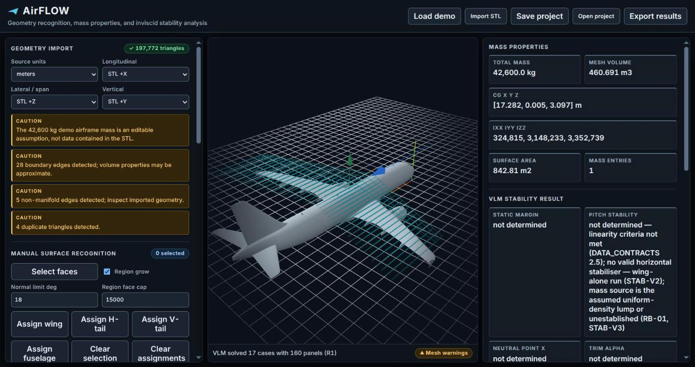

# AirFLOW / FlowSync

> FlowSync v2 Phase 0 Launch

A browser-based preliminary aerodynamics and CFD workbench: import an aircraft STL, label its
components, compute mass properties, run a vortex-lattice aerodynamic sweep, inspect results,
and export versioned JSON — all with explicit validity records.

Built by **Ragib Mahmud Ansary** as an engineering research/AI-automation project. This is a
genuine, documented work in progress — not a certificated analysis tool.



---

## What works today

| Capability | Status |
| --- | --- |
| STL import (binary/ASCII), units and axis mapping | Working |
| Mass properties — volume, CG, inertia (validated against an analytic cylinder to 5 digits) | Working |
| Triangle picking and region growth for component labels | Working |
| Manual wing / H-tail / V-tail / fuselage assignment | Working |
| Multi-row VLM lift slope | Within 3–6 % of lifting-line theory |
| 192 Node tests, independent-oracle verification records | Passing (192/192) |
| JSON project + result export with validity metadata | Working |

## Known limitations — read before trusting any number

From [`docs/START_HERE.md`](docs/START_HERE.md) and the discrepancy register (M0 in progress):

- Wing planform extraction is **wrong** (−63 % area on a clean selection).
- VLM induced drag `C_Di` has the **wrong sign and 9–16× magnitude**.
- The pitch-response plot is **non-physical** (linearised demonstrator only).
- The OpenFOAM CFD pipeline (meshing, solver, C<sub>p</sub>, streamlines) is **not implemented**.
- All results are incompressible, inviscid, flat-plate, M < 0.3 only. No stall, camber, twist or
  fuselage interference.

The project rule is explicit: **"A number without a validity record and provenance is not a result."**
Invalid or missing-validity sweeps export `null` coefficients rather than plausible-looking values.

## Stack

- Vanilla ES modules — no framework, no bundler, no backend
- three.js r160, vendored as a single file in `vendor/three/`
- Node static server (`npm start`, port 4173)
- Node built-in test runner (`npm test`)

## Quick start

```bash
npm start          # http://localhost:4173
npm test           # 192 tests
```

Requires Node.js 24+ (developed on v24.21.0).

## Documentation

| Document | What it covers |
| --- | --- |
| [`docs/START_HERE.md`](docs/START_HERE.md) | Repository snapshot, verified capabilities, reading order |
| [`docs/architecture/DATA_CONTRACTS_AND_PIPELINE.md`](docs/architecture/DATA_CONTRACTS_AND_PIPELINE.md) | Normative frame, formulas, schemas, validity gates |
| [`docs/architecture/REVISED_SYSTEM_ARCHITECTURE.md`](docs/architecture/REVISED_SYSTEM_ARCHITECTURE.md) | Subsystems and state ownership |
| [`docs/audits/DISCREPANCY_REGISTER.md`](docs/audits/DISCREPANCY_REGISTER.md) | Defects DR-01… with root causes |
| [`docs/audits/ADVERSARIAL_PLAN_REVIEW.md`](docs/audits/ADVERSARIAL_PLAN_REVIEW.md) | 47 objections with dispositions |
| [`MVP_METHODOLOGY.md`](MVP_METHODOLOGY.md) | Current browser implementation method |
| [`CALCULATION_PIPELINE.md`](CALCULATION_PIPELINE.md) | Exact calculation path |
| [`docs/verification/`](docs/verification/) | Independent verification records and UI regression captures |

## Demo data

The A320 demo STL is **not included** in this repository. Its licence is unconfirmed (open
question Q-7 in the project records), so it is excluded from the public push. Supply your own
watertight STL to use the geometry and VLM features. The app also ships with a synthetic
rectangular-wing self-test case.

## Roadmap

M0 (numerics + quarantine) → M1b (framework + guided workspaces) → M2 (camber/twist) →
M4a (pinned OpenFOAM, 2-D NACA 0012 validation) → M6/M8 (validated stability claims).

## Author

Ragib Mahmud Ansary — aerospace engineering student; freelance CFD, meshing and simulation work.

- Cadcrow: [cadcrow.com](https://www.cadcrow.com)
- Portfolio: *add live URL after deployment*
- Fiverr portfolio: [mahmud_orko_](https://www.fiverr.com/users/mahmud_orko_/portfolio/)

## Licence

Code licence to be confirmed by the author. Vendored three.js is MIT licensed (see its header).
Third-party geometry fixtures with unconfirmed licences are excluded (see `.gitignore`).
