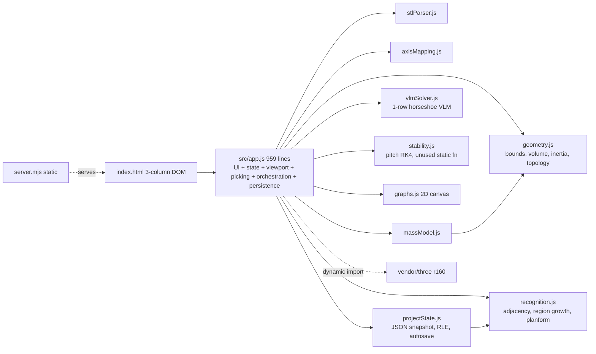
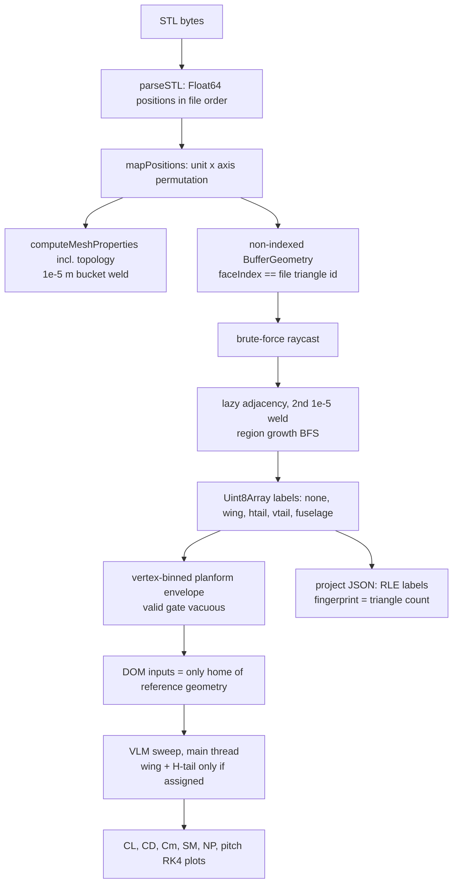

# Current System Architecture (as built, `25afe85`)

Status: **Authoritative snapshot** of the code as of 2026-10-23. Detailed evidence is in [REPOSITORY_IMPLEMENTATION_AUDIT.md](../audits/REPOSITORY_IMPLEMENTATION_AUDIT.md) §2-7 (module graph, data flow, state ownership, lifecycle) and [UI_AND_SELECTION_AUDIT.md](../audits/UI_AND_SELECTION_AUDIT.md) §2.

## What it is

A dependency-free, single-page browser application ("AirFLOW Stability MVP").

**Stack:**
- Static HTML and vanilla ES modules.
- three.js r160 vendored as a single file, with no addons.
- A 76-line Node static file server (`server.mjs`).
- 23 Node tests (`npm test`, all passing on Node v24.21.0).
- No framework, bundler, backend, dependencies, TypeScript or CI.

**What it does:**
1. Imports a binary or ASCII STL.
2. Applies a unit scale and an axis permutation.
3. Computes mass properties.
4. Lets the user label triangles with 4 fixed component types.
5. Derives a wing planform from labelled triangles.
6. Runs a one-row horseshoe VLM α-sweep.
7. Computes a static margin and a "pitch response".
8. Draws 2D canvas plots.
9. Saves project JSON and results CSV.

**What it does not have:**
- parametric geometry;
- surface or patch identity;
- boundary conditions or a fluid domain;
- CSG or export for a solver;
- meshing or a CFD solver;
- C_p, flow fields or streamlines;
- a C_L-vs-C_D plot or C_L,max.

## Module structure

## Data and identity flow

## Verified properties of the current system

| Area | Fact | Evidence |
|---|---|---|
| Identity | The only identity is the file triangle index. There is no surface, patch or boundary-condition object. | UI audit §2.10 |
| Topology | Two independent absolute-tolerance welds. Reported 8/85/80 (boundary edges / non-manifold edges / degenerate triangles) are artefacts. The exact topology is 28/5/0, in a single shell. | Discrepancy register V-2 |
| Picking | Brute force, 6.5 ms per ray (Node); 19-32 ms per full pick (browser); first pick 942 ms because adjacency is built lazily. | Repository audit §7.3 |
| Memory | 79 MiB CPU-side for 197,772 triangles. | Repository audit §7.5 |
| Lifecycle | One-shot `bootstrap()`. No teardown, no `renderer.dispose()`, no context-loss handling. A WebGL failure aborts the whole app. | Repository audit §6-7; register DR-24 |
| State | A module-private `state` object plus DOM inputs as a second source of truth. Imperative re-render. No store. | Repository audit §4.1 |
| Correctness | Induced drag is wrong (sign and 9-16× magnitude). Planform area is −63%. The pitch model is non-physical. The stability verdict is wing-alone by default. | Register DR-01..DR-06 |
| Correct and reusable | Mass and inertia, the Biot–Savart kernel, the linear solver, STL parsing, axis-mapping validation. | Register §6 |
