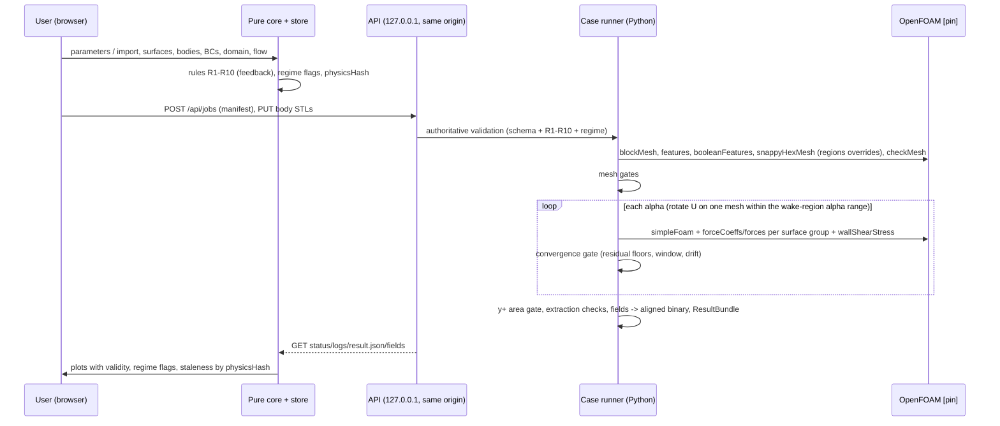

# Data Contracts, Mathematical Definitions and Pipeline

Status: **v1.0, normative**, revised after the adversarial review (2026-10-23). This document **wins any conflict** with other plan documents. Changes driven by objections are tagged with their objection id (`RA-xx`, `RB-xx`); see [ADVERSARIAL_PLAN_REVIEW.md](../audits/ADVERSARIAL_PLAN_REVIEW.md).

Syntax tagged **[pin]** is OpenFOAM-version-specific. It must be confirmed on the pinned installation (CFD-T1) before use.

Reviewer B checked the following by derivation and script, and they survived:
- the frame and wind axes at β = 0;
- moment transfer;
- NP and SM at a common height;
- the half-model A_ref;
- C_p with kinematic pressure;
- ISA and Sutherland;
- ω = k/ν_t;
- the y⁺ factor of 2;
- the c/4 → leading-edge sweep conversion;
- the NACA and superellipse formulas.

---

## 1. Frame, units, notation

| Item | Definition |
|---|---|
| Units | SI. In OpenFOAM incompressible solvers, pressure is kinematic: p_k = p/ρ in m²/s². |
| Frame | Right-handed body frame: **x** aft (downstream), **y** starboard, **z** up. This is the repository's existing frame. |
| Moment sign | +M_y and +C_m are **nose-up**. |
| Sideslip convention | Etkin convention: β > 0 when the relative wind comes from starboard. |
| Freestream (air relative to aircraft) | **U**∞ = V (cos α cos β, **−sin β**, sin α cos β). The β sign is corrected from v0.9 to match the convention above. CFD scope is β = 0. The current VLM code uses (cos α cos β, cos α sin β, sin α) (DR register B-VLM-09). It must adopt this form when sideslip is enabled. |
| Wind axes (β = 0) | ê_D = (cos α, 0, sin α), ê_L = (−sin α, 0, cos α) |
| Body-axis force coefficients (β = 0) | C_X = −C_L sin α + C_D cos α<br>C_Z = C_L cos α + C_D sin α (RB-10) |
| Reference quantities | S (full aircraft), c̄ (MAC), b (span), and the moment reference r_ref together with its source. Every C_m carries `momentReference` and `source`. |
| Axis-map determinant | det = −1 means the import mirrors the geometry. The importer flips triangle winding and records `det`. |

## 2. Mathematical definitions

### 2.1 Freestream, similarity and regime flags

**Definitions:**
- q∞ = ½ρV²
- Re = V c̄/ν, with ν = μ/ρ
- M = V/a, with a = √(γRT), γ = 1.4, R = 287.05 J/(kg K)

**ISA troposphere** (h ≤ 11 km):
- T = 288.15 − 0.0065 h
- p = 101325 (T/288.15)^5.25588
- ρ = p/(RT)
- μ = 1.458e-6 T^1.5/(T + 110.4)

**Regime flags.** These attach to **every coefficient record** (§7.4), not just to a banner (RB-06, RB-11).

| Flag | Condition | Effect |
|---|---|---|
| `mach` | M > 0.3 | **Error.** Export refused (R8). |
| `mach` | 0.2 < M ≤ 0.3 | Warning: "incompressible lift-slope bias ≈ −(1 − √(1−M²)) relative to compressible air". The value is reported, for example −2.3 % at M = 0.212. |
| `mach` | M ≤ 0.2 | Bias reported only. C_L,max claims are allowed only at M ≤ 0.2. |
| `reynolds` | Re_c̄ < 5e5 | **`regime: invalid`**: fully turbulent RANS cannot represent laminar separation or transition. Every coefficient is labelled "not physically valid". There is no committed transition model; see Q-2. |
| `reynolds` | 5e5 ≤ Re_c̄ < 2e6 | Warning: transition effects possible. |
| `wallTreatment` | Applicability per §2.3 | Error, or `invalid` |

### 2.2 Turbulence inflow (k-ω SST)

Defaults are bounded by the NASA TMR SST far-field guidance, where L_dom is the computational-domain x-length (RB-12):
- 1e-5 V²/Re_L < k∞ < 0.1 V²/Re_L
- V/L_dom < ω∞ < 10 V/L_dom
- 1e-5 ≤ μ_t/μ ≤ 1e-2

Default values:
- ω∞ = 5 V/L_dom
- ν_t∞ = 1e-3 ν
- k∞ = ν_t∞ ω∞

These sit at about 5e-3 of the upper k bound.

**Reporting.** Each result records:
- the inlet values;
- the implied intensity I = √(2k/3)/V;
- **probed** k and ν_t/ν at one body length upstream of the nose. Freestream SST turbulence decays strongly over the domain, so the inlet value is not what the body sees.

User overrides outside the bounds are allowed with a warning.

### 2.3 Wall treatment and first-cell height (RB-06, RB-08, RB-23)

**Estimates** (empirical, used for mesh setup only):
- C_f ≈ 0.026 Re_x^(−1/7) at x = c̄
- u_τ = √(q∞ C_f/ρ)
- y₁ = y⁺ν/u_τ
- First-cell height h₁ = 2y₁ (cell-centred)
- Turbulent boundary-layer thickness δ ≈ 0.37 c̄ Re_c̄^(−1/5)

Local y⁺ varies roughly 1.4-1.7× over a wing, so y⁺ is gated by area fraction, not by its mean.

| Mode | Target | Applicability (fails closed) | Wall-function BC [pin] |
|---|---|---|---|
| `lowRe` | y⁺ ≈ 1; y⁺ ≤ 5 on ≥ 90 % of the wall area | Always applicable | `nutLowReWallFunction` |
| `wallFunction` | 30 ≤ y⁺ ≤ 300 on ≥ 90 % of the wall area | **δ ≥ 10 h₁**. Otherwise refused (for example, a UAV at Re 2.6e5 gives δ/h₁ ≈ 3.7). | `nutkWallFunction` |

The production default is **not fixed until VAL-Y1**. Until then:
- validation cases use `lowRe`;
- a validated regime covers only the wall treatment it was validated with.

### 2.4 Forces, moments, coefficients

| Quantity | Definition |
|---|---|
| Force | **F** = ∮[−(p − p∞)**n** + **τ**_w] dA. **n** points out of the body into the fluid. Pressure and viscous parts are reported separately. |
| Moment | **M** = ∮(**r** − **r**_ref) × d**F** |
| Lift and drag | L = **F**·ê_L, D = **F**·ê_D |
| Coefficients | C_L = L/(q∞S), C_D = D/(q∞S), C_m = M_y/(q∞Sc̄) |
| Half model (`symmetryPlane` at y = 0) | A_ref = S/2, c̄ unchanged. This gives full-aircraft C_L, C_D and C_m. **Dimensional forces shown to users are always C·q∞·S (full aircraft), never raw half-model integrals** (RB-24). |
| Per-group coefficients | Normalised by the **aircraft** S and labelled "contribution to aircraft C_L". Never overlaid on an isolated-wing VLM result (RB-24). |
| C_p | (p − p∞)/q∞. Kinematic form: (p_k − p_k∞)/(½V²). |
| C_f display | Primary: \|**τ**_w\|/q∞. Optional: the component along the surface projection of ê_D, labelled "streamwise component" and undefined where **n** ∥ ê_D (RB-23). |

### 2.5 Moment transfer, neutral point, static margin, verdicts

**Moment transfer.** With Δ = r_A − r_B:

C_m,B = C_m,A + (Δz C_X − Δx C_Z)/c̄

This is exact; the body-axis C_X and C_Z come from §1.

**Neutral point** (RB-10):
- The NP is defined **at the CG height**, z = z_CG.
- The static margin is computed **only from C_m referenced to the CG**:
  - SM = −dC_m,CG/dC_Z, approximately −dC_m,CG/dC_L at small α
  - x_NP = x_CG + SM·c̄
- The quarter-MAC reference r_c/4 = (x_MAC + c̄/4, 0, z_MAC) is used for reporting only, never for SM. The v0.9 "include the vertical term when |Δz|C_D/c̄ > 0.002" criterion is withdrawn; it under-estimated the effect by about 15×.

**Linearity.** A slope (C_Lα, C_mα) needs:
- ≥ 3 converged points in the fit window (|α| ≤ 5° by default);
- every adjacent-pair slope within 5 % of the window's least-squares slope.

Otherwise it is "non-linear: not determined" (RB-21). R² is not used.

**Stability verdict rules.** A verdict ("statically stable / unstable") is shown only if **all** of the following hold:
1. A horizontal stabiliser is present.
2. The mass source is not the default uniform-density lump (`mass.source ≠ assumedUniform`) (RB-01).
3. The linearity criteria above are met.
4. The model description is printed with the verdict:
   - **Tier-0:** "wing + H-tail flat-plate VLM; fuselage, camber and twist omitted; fuselage omission over-estimates SM".
   - **CFD:** "unvalidated" until VAL-E2 passes (RB-02).

**Trim.** α_trim solves C_m,CG = 0. It is reported only if C_L(α_trim) > 0 and α_trim lies inside the sweep.

### 2.6 Coefficient curves and C_L,max

**Curve drawing.**
- Points come only from cases that passed the convergence gate (§7.3).
- Unconverged points are drawn hollow and excluded from fits. **Lines break at unconverged points** (RB-24).
- No interpolation.

**C_L,max** (RB-13). Allowed only when all of these hold:
- **full model** (no symmetry plane, so asymmetric stall is possible);
- M ≤ 0.2;
- `regime` valid;
- α step ≤ 1° within ±3° of the observed peak.

Procedure:
1. **Reported value:** the maximum of a local quadratic fit through ≥ 5 converged points spanning the peak, with an uncertainty from the fit residual and the step.
2. **Ascending sweep:** continuation from the lower α.
3. **Descending sweep:** continuation from a converged post-peak solution.
4. Compare C_L at each α within ±3° of the peak. If |ΔC_L| > 0.05 anywhere, report "hysteresis: C_L,max not determined" and show both branches.

The label is always "steady-RANS stall-onset estimate". **"Not determined" is the expected common outcome and is not a failed deliverable.**

### 2.7 Tier-0 VLM (M0b)

| Element | Definition |
|---|---|
| Discretisation | M chordwise rows (default 4) × N spanwise panels per surface, uniform spacing in both directions. N is chosen so the panel width/length ≈ 1 at the mean chord. **Single guard: refuse any panel with width/length < 0.25.** Values above 8 trigger a coarse-spanwise warning. Elliptic tip strips reach about 4.5 legitimately (RA-03, RB-04; review record §4). |
| Normals | Flat plate plus surface incidence (M0b). Camber slope and twist from the generated sections are added in M2-9 (RB-01). |
| Wake | Straight legs **aligned with the freestream** (ê_w = ê_D), as in the current code. Length ≥ 10 b of the largest surface (B-VLM-07, RB-07).<br>*Post-review check:* a planar wake along +x makes near-field drag = Trefftz drag × cos α, an O(α²) inconsistency (−1.5 % at 10°). With a freestream-aligned wake the two agree to 0.001 % for wing and for wing + tail. The influence matrix is therefore rebuilt per α. |
| Bound-midpoint induced velocity | **v**_i = Σ_j Γ_j **q**_j(**m**_i). For j = i only the bound segment is excluded (`includeBound = j !== i`) (DR-01). |
| Near-field force | **F**_i = ρΓ_i(**U**∞ + **v**_i) × **l**_i. Gives lift and moment. |
| Trefftz drag (primary; RB-03) | D = ½ρ Σ_i Γ_i **v**_T(**m**_i⊥)·(**l**_i × ê_w), where ê_w is the wake direction. **v**_T is the 2-D velocity in the Trefftz plane (⟂ ê_w), induced by **all trailing legs of all surfaces** treated as infinite line vortices through their projected endpoints. The orientation comes from the 3-D horseshoe: the leg at `boundA` points upstream and the leg at `boundB` points downstream. **m**_i⊥ is the projected bound midpoint. **No absolute value anywhere; assert D > 0.** |
| Near-field vs Trefftz | A diagnostic, gated only for unswept planar wings (≤ 1 %). On swept wings the midpoint rule on kinked bound lines differs by 2-12 % (RB-07), so the difference is reported but not gated. |
| Uncertainty statement | Tier-0 results are labelled "flat-plate inviscid estimate: C_Lα ±5 %, C_Di ±8 %, from oracle comparisons (register §1, review §4)". |
| Singularity cutoff | Relative: 1e-6 × segment length. |
| Sweep input | Λ is defined at c/4: tan Λ_LE = tan Λ_c/4 + (c_r − c_t)/(2b). |
| Outputs | C_L, C_Di, C_m and x_NP as validity records. "C_D" is shown only as "C_Di (VLM) + assumed C_D0". |

## 3. Geometry generation (M2)

### 3.1 NACA 4-digit section `MPTT`

- m = M/100, p = P/10, t = TT/100.
- Thickness: y_t = 5t(0.2969√x − 0.1260x − 0.3516x² + 0.2843x³ + a₄x⁴).
  - **`trailingEdge: "blunt"` (default for CFD export; RB-15, RB-19):** a₄ = −0.1015, the standard definition matching the tabulated ordinates. The trailing-edge thickness is 0.252 % c at t = 0.12, closed by a planar `<comp>_te_base` surface.
  - `trailingEdge: "sharp"`: a₄ = −0.1036, a zero-thickness trailing edge. Allowed for VLM and analysis. CFD export warns that layer collapse is likely.
- Camber line:
  - y_c = (m/p²)(2px − x²) for x < p
  - y_c = (m/(1−p)²)((1−2p) + 2px − x²) for x ≥ p
  - θ = atan(dy_c/dx)
- Upper and lower surfaces:
  - x_U = x − y_t sin θ, z_U = y_c + y_t cos θ
  - x_L = x + y_t sin θ, z_L = y_c − y_t cos θ
- Sampling: cosine, N_c ≥ 60 points per surface.
- The **TMR NACA 0012** (t/c = 11.897 %, closed by extension and rescaling) is a separate validation fixture taken from the TMR coordinate file. It is never produced by this generator (RB-05).

### 3.2 Lofted lifting surface

**Span parameters (RB-16).**
- `span: "full"`: **b** is the projected tip-to-tip span; η ∈ [−1, 1]; y = ηb/2.
- `span: "semi"`: **s** is the projected root-to-tip length along the local span axis; η ∈ [0, 1]; y_local = ηs.

**Per station, in order:**
1. Chord c(|η|) = c_r(1 − (1 − λ)|η|).
2. Twist θ(|η|) = θ_r + (θ_t − θ_r)|η|, applied as a rotation about +y through the local c/4 point. θ > 0 is nose-up.
3. Shear:
   - x += x_LE,root + |y_local| tan Λ_LE
   - z += z_root + |y_local| tan Γ
   - Sections stay streamwise.
4. Stations are cosine-clustered toward the tips.

**Closure.**
- `full`: tip caps `tip_l` and `tip_r`.
- `semi`: tip cap `tip` and root cap `root`. The root cap must satisfy R6b (buried).

**Placement.** A `semi` surface is generated on the +y side and rigidly rotated about +x by the mount angle φ:
- 0 for a horizontal surface;
- 90° for a fin;
- +φ_V for the right half of a V-tail.

**Left counterparts are mirror images** (y → −y, with the winding flipped). The mirror keeps pitch, twist and incidence signs unchanged (RB-16).

**Surfaces:** `<comp>_upper`, `<comp>_lower`, `<comp>_tip[_l|_r]`, `<comp>_root`, `<comp>_te_base`.

### 3.3 Superellipse fuselage

The section at station x is |y/a(x)|^n + |(z − z_c(x))/b(x)|^n = 1, sampled by arc length.

| Exponent | Shape |
|---|---|
| n = 2 | Ellipse |
| n > 2 | Flat-sided |
| 1 < n < 2 | Pinched: C¹, infinite curvature at the axis points |
| **n ≤ 1** | Corners (chines), with feature edges extracted |

- **Profiles:** an elliptic nose, a constant section, and a tail cone with optional upsweep.
- **Closure:** each end collapses to an apex vertex with a triangle fan.
- **Surfaces:** `fuselage_nose`, `fuselage_body`, `fuselage_tail`.
- **Oracle:** section area = 4ab Γ(1+1/n)²/Γ(1+2/n).

### 3.4 Empennage configurations

Notation: s_v is the fin semi-span (its height), b_h is the stabiliser span, and "mirror" means the reflection defined in §3.2. The interpretation of "inverted-U" is open question Q-5.

| Config | Horizontal | Vertical |
|---|---|---|
| Conventional | `htail` full, φ = 0, on the aft fuselage | `vtail` semi, φ = 90°, y = 0 |
| T-tail | `htail` full, at the fin tip: x = x_LE,root,v + s_v tan Λ_LE,v; z = z_root,v + s_v | `vtail` semi, φ = 90° |
| V-tail | — | `vtail_r` semi, φ = +φ_V (upward dihedral); `vtail_l` = mirror |
| H-tail | `htail` full | `vtail_r` semi, φ = 90°, at y = +b_h/2; `vtail_l` = mirror |
| Inverted-U | `htail` full, span 2y_f, at z = z_root,v + s_v | `vtail_r` at y = +y_f; `vtail_l` = mirror |

Junctions must overlap by at least max(2 target surface cells, 0.02 c_local) of penetration depth: tail into fuselage, stabiliser into fin (R6b; RB-15).

## 4. Identity, naming, persistence (RA-01, RA-06, RA-07, RA-10, RA-11, RA-16)

### 4.1 Objects

| Object | Contract |
|---|---|
| Surface | A named face set. **Generated:** identified by name, assigned by construction; never re-tagged per triangle. **Imported:** `surfaceOf: Int32Array(nTri)` over `triangleId` (file order). |
| Body | A closed shell; the unit of closure and export. One STL file per body, with one `solid` per surface. A generated part is one body. An imported fused shell is one body with many surfaces. |
| Component | A semantic group (wing, fuselage, htail, vtail, nacelle, pylon, other; side). Used for force breakdown and the UI. A component may span bodies, and a body may contain several components. |
| `patchNameOf(body, surface)` | **= surface.** The case builder emits `regions { <solid> { name <solid>; } }` for every region, so that snappyHexMesh does not prefix the body name. Verified on the pinned version (CFD-T1). |
| `expectedEmpty` | Surfaces with no wetted area: buried caps, and bodies wholly outside a half-model domain. Computed by the exporter (inside test, domain clip), listed in the manifest, and excluded from force groups. |

### 4.2 Names

- Regex: `^[A-Za-z][A-Za-z0-9_]*$`.
- Length: surfaces ≤ 40 characters, bodies and components ≤ 24.
- Unique **case-insensitively** across surfaces, bodies and components.
- Reserved: `inlet`, `outlet`, `side`, `side_neg`, `symmetry`, `top`, `bottom`, `internalMesh`, `defaultFaces`, `default`, `frontAndBack`.

### 4.3 Imported `solid` names

Sanitised deterministically, in this order:
1. Trim whitespace.
2. Replace invalid characters with `_`.
3. Prefix a leading digit with `s_`.
4. Rename an empty name to `solid_<k>`.
5. Rename a reserved word to `<name>_s`.
6. Suffix duplicates `_2`, `_3`, …, in file order.

Test: SURF-T4.

### 4.4 Hashes

| Hash | Definition | Use |
|---|---|---|
| `meshHash` (imported) | SHA-256 over `"airflow-mesh-v1"` ‖ nTri ‖ positions (float64 LE) ‖ triangles (uint32 LE), after unit and axis mapping | Project binding |
| `paramsHash` (generated) | SHA-256 of canonical JSON (sorted keys) of `AircraftParams` plus `generatorVersion`. Avoids cross-engine floating-point differences in `Math.cos`/`pow`. | Project binding |
| `inputsHash` | FNV-1a, synchronous, over canonical JSON of the relevant store slices plus `meshHash`/`paramsHash` | Live staleness |
| `physicsHash` | SHA-256 over canonical physics content of the manifest (everything except `provenance`) ‖ sorted body-file SHA-256s. Computed by the exporter and recomputed by the backend. | Result identity and staleness |

All SHA-256 uses `crypto.subtle`, which is available in Node 24 and the browser. Snapshot save is async.

### 4.5 Project file

- Schema `airflow.browser-project` **version 2**, keeping the existing id.
- `{source, aircraftParams?, surfaces, bodies, components, boundary, domain, flow, reference, solverSettings, mass, jobs}`.

**Loading:**
- **Imported:** re-import the STL, then compare `meshHash`. On mismatch the surfaces are rejected.
- **Generated:** regenerate from the parameters, then compare `paramsHash`.
- Unit and axis mapping are applied before the surfaces.

**v1 → v2 migration:** the four labels become surfaces. There is no hash, so the user must confirm the binding explicitly.

## 5. Boundary model

### 5.1 Vocabulary

| Tag | Meaning | Allowed on |
|---|---|---|
| `FARFIELD` | Freestream type; supports α sweeps by rotating **U**∞ | Outer domain faces |
| `VELOCITY_INLET` | Prescribed U, k, ω | Outer faces (tunnel mode) |
| `PRESSURE_OUTLET` | Prescribed p | Outer faces (tunnel mode) |
| `SLIP_WALL` | Zero normal velocity, zero shear | Outer faces (tunnel mode) |
| `SYMMETRY` | Mirror plane | Only the planar face y = 0, in half-model mode |
| `WALL_NOSLIP` | Viscous wall | Aircraft surfaces (default) |

### 5.2 Rules

Every rule is enforced by the browser (for feedback) **and authoritatively by the backend** (RA-14). Each failure reports the rule id and the surfaces involved.

| Rule | Requirement |
|---|---|
| R1 | Every domain face and every non-`expectedEmpty` aircraft surface has exactly one tag. |
| R2 | `SYMMETRY` requires all of: half-model mode; the face is the plane y = 0; β = 0; and mirror symmetry of the aircraft, with Hausdorff distance ≤ 1e-4 L_ref (computed with the spatial index). Half models are **not allowed** for C_L,max runs (§2.6). |
| R3 | Far-field mode: every outer face except `SYMMETRY` is `FARFIELD`. |
| R4 | Tunnel mode: one `VELOCITY_INLET` with n·ê_D < 0, and one `PRESSURE_OUTLET` with n·ê_D > 0. Other outer faces are `SLIP_WALL` or `SYMMETRY`. An α sweep means rotating the geometry and re-meshing per α. |
| R5 | `WALL_NOSLIP` on an outer face is an error, unless the research "tunnel walls" option is enabled. |
| R6 | Every exported body is closed: 0 open edges, 0 non-manifold edges and **no self-intersection**. Alternatively, the backend repair report shows closure. |
| R6b | Every `expectedEmpty` surface (caps) lies **strictly inside** another closed body. Checked with an exact inside test (winding number with the spatial index), with clearance ≥ 2 target surface cells. Junction penetration depth follows §3.4. **An exposed cap is an error** (RB-15). |
| R7 | References: S, c̄ and b are positive. r_ref is the CG, together with its source. Half model: A_ref = S/2 automatically. |
| R8 | Regime: M > 0.3 is an error. Other flags follow §2.1. `wallFunction` is refused when δ < 10 h₁ (§2.3). |
| R9 | Domain extents are at least the minimum multiples (§6.1). |
| R10 | Names and patch set: all names valid per §4.2, and force groups reference only non-empty surfaces. |

### 5.3 OpenFOAM mapping (simpleFoam, kinematic p, k-ω SST) [pin]

| Tag | Patch type | U | p | k | ω | ν_t |
|---|---|---|---|---|---|---|
| `FARFIELD` | patch | `freestreamVelocity` (**U**∞) | `freestreamPressure` (0) | `inletOutlet` (k∞) | `inletOutlet` (ω∞) | `calculated` |
| `VELOCITY_INLET` | patch | `fixedValue` **U**∞ | `zeroGradient` | `fixedValue` k∞ | `fixedValue` ω∞ | `calculated` |
| `PRESSURE_OUTLET` | patch | `inletOutlet` (0) | `fixedValue` 0 | `inletOutlet` k∞ | `inletOutlet` ω∞ | `calculated` |
| `SLIP_WALL` | patch | `slip` | `zeroGradient` | `zeroGradient` | `zeroGradient` | `calculated` |
| `SYMMETRY` | symmetryPlane | `symmetryPlane` | `symmetryPlane` | `symmetryPlane` | `symmetryPlane` | `symmetryPlane` |
| `WALL_NOSLIP` | wall | `noSlip` | `zeroGradient` | `kqRWallFunction` | `omegaWallFunction` | per §2.3 |

## 6. Fluid domain and meshing

### 6.1 Three-dimensional domain

- L_ref = max(b, x-extent of the aircraft).
- Extents: f_u L_ref upstream, f_d L_ref downstream, f_s L_ref laterally and vertically. Half model: y_min = 0.
- Defaults f_u = 5, f_d = 10, f_s = 5. Minimums 3 / 6 / 3, from the requirement.
- The defaults are engineering choices. VAL-D1 confirms them by Richardson-estimated residual, with the near-body mesh frozen (RB-18).
- Faces are named `inlet`, `outlet`, `side`, `symmetry` or `side_neg`, `top`, `bottom` (reserved names).

### 6.2 Two-dimensional validation exception (RB-05)

The 3-D domain rule does **not** apply to CFD-T2. The NACA 0012 baseline uses:
- the TMR grid family, with its far field at about 500 chords; or
- an extruded 2-D mesh (blockMesh / `extrudeMesh`, one cell thick, `empty` front and back) with a far field ≥ 100 chords plus a point-vortex correction.

A snappyHexMesh slab is run only to **quantify** mesher-induced error.

### 6.3 Mesh stages [pin]

1. **`blockMesh`**.
2. **`surfaceFeatureExtract`** (or `surfaceFeatures`) per body, with an included angle of 150°.
3. **`surfaceBooleanFeatures intersection`** for each intersecting body pair listed in the manifest.
4. **`snappyHexMesh`**:
   - Surface target sizes per surface group (the backend converts them to levels).
   - Leading- and trailing-edge refinement regions.
   - **A wake refinement region covering the wake directions of every α in the sweep.** It extends downstream X_w, and vertically ± (X_w tan α_max + margin). If the sweep spans more than 10°, it is split into sub-sweeps with separate meshes (RB-14).
   - `regions` name overrides (§4.1).
   - `locationInMesh` computed by an inside test.
   - Layers on `WALL_NOSLIP` patches per the wall mode.
5. **`checkMesh`**, parsed into a MeshReport.

**Cell estimate.** The backend dry-run (`/api/estimate`) computes the cell estimate; the browser does not. The default ceiling is 6e6 cells on the 14 GB host, calibrated in M4.

## 7. Backend contracts

### 7.1 Case manifest (abridged example)

The authoritative schema is `schemas/case-manifest.schema.json`. The example is a GA-like wing-body at Re 2.7e6 and M 0.12, chosen to be consistent with the host budget (RB-08).

```json
{
  "schema": "airflow.case-manifest/1",
  "units": "SI", "frame": "x_aft_y_starboard_z_up",
  "source": {"kind": "generated", "paramsHash": "sha256:…", "generatorVersion": "1.0.0"},
  "bodies": [
    {"body": "wing", "file": "geometry/wing.stl", "sha256": "…", "components": ["wing"],
     "surfaces": ["wing_upper", "wing_lower", "wing_tip_l", "wing_tip_r", "wing_te_base"]},
    {"body": "fuselage", "file": "geometry/fuselage.stl", "sha256": "…", "components": ["fuselage"],
     "surfaces": ["fuselage_nose", "fuselage_body", "fuselage_tail"]}
  ],
  "expectedEmpty": ["wing_tip_l"],
  "intersections": [["wing", "fuselage"]],
  "boundary": {"wing_upper": "WALL_NOSLIP", "wing_lower": "WALL_NOSLIP", "wing_tip_r": "WALL_NOSLIP", "wing_te_base": "WALL_NOSLIP",
               "fuselage_nose": "WALL_NOSLIP", "fuselage_body": "WALL_NOSLIP", "fuselage_tail": "WALL_NOSLIP"},
  "reference": {"areaM2": 16.2, "chordM": 1.50, "spanM": 11.0, "momentReferenceM": [2.9, 0.0, 0.05],
                "momentReferenceSource": "massManifestCG", "quarterMacM": [2.75, 0.0, 0.0], "halfModel": true, "aRefM2": 8.1},
  "flow": {"speedMS": 40.0, "densityKgM3": 1.225, "kinematicViscosityM2S": 1.4607e-5, "temperatureK": 288.15,
           "alphaDeg": [-2, 0, 2, 4, 6], "betaDeg": 0, "inflow": {"omegaFactor": 5, "viscosityRatio": 1e-3}},
  "derived": {"reynolds": 4.11e6, "mach": 0.118, "flags": {"mach": "ok", "reynolds": "ok"}},
  "domain": {"mode": "farfield", "lRefM": 11.0, "lRefPolicy": "max(span, xExtent)",
             "factors": {"upstream": 5, "downstream": 10, "side": 5},
             "faces": {"inlet": "FARFIELD", "outlet": "FARFIELD", "side": "FARFIELD", "symmetry": "SYMMETRY", "top": "FARFIELD", "bottom": "FARFIELD"}},
  "mesh": {"preset": "medium", "surfaceCellM": {"wing": 0.02, "fuselage": 0.04}, "wake": {"lengthM": 15.0, "alphaRangeDeg": [-2, 6]},
           "wallTreatment": "lowRe", "layers": {"yPlusTarget": 1, "count": 15, "expansion": 1.2}, "maxCells": 6000000},
  "solver": {"application": "simpleFoam", "turbulenceModel": "kOmegaSST", "maxIterations": 4000},
  "outputs": {"forceGroups": {"total": ["wing_upper", "wing_lower", "wing_tip_r", "wing_te_base", "fuselage_nose", "fuselage_body", "fuselage_tail"],
                              "wing": ["wing_upper", "wing_lower", "wing_tip_r", "wing_te_base"]},
              "surfaceFields": ["p", "wallShearStress"], "slices": [{"normal": [0, 1, 0], "originM": [0, 2.75, 0]}]},
  "provenance": {"appVersion": "…", "created": "…"}
}
```

Notes:
- `wing_tip_l` is listed as `expectedEmpty` because it lies at y < 0, outside the half-model domain.
- Re in `derived` uses c̄ = 1.5 m.
- Names are checked against the reserved list.

### 7.2 Mesh gates (MeshReport) (RB-08)

Thresholds are calibrated in M4; any change is recorded.

| Check | Gate |
|---|---|
| `checkMesh` | No fatal errors |
| Non-orthogonality | Max ≤ 70° (hard; the "severe" limit). The fraction above 65° is reported. |
| Skewness | Internal faces ≤ 4; boundary faces ≤ 20 [pin: snappy `meshQualityControls` defaults] |
| Layer coverage | ≥ 90 % on lifting-surface patches and ≥ 80 % on other walls (production); ≥ 95 % (validation) |
| Layer-to-core transition | Last-layer thickness / adjacent core-cell size ≥ 0.3 (engineering; calibrate) |
| y⁺ (evaluated after the first solve) | ≥ 90 % of the wall area within the band of the chosen mode (§2.3). Failure invalidates the result and triggers a re-mesh suggestion. |
| Patch set | `boundary` patches = manifest surfaces − `expectedEmpty` + domain faces (MESH-T3) |
| Cell count | ≤ `maxCells` |

### 7.3 Convergence gate, per α (RB-09)

All of the following must hold:
- **(a) Residuals.** Final initial residuals at or below absolute floors: p ≤ 1e-4; U, k, ω ≤ 1e-5 [calibrate in M4]. For a cold start, ≥ 4 orders of drop from the first iteration is also accepted. Continuation runs use the floors only.
- **(b) Window.** Over W = max(200, 10 % of iterations):
  - C_L and C_D: |max − min| ≤ max(1e-3·|mean|, 1e-4)
  - C_m: |max − min| ≤ 2e-4
- **(c) Drift.** For the least-squares slope over the window, |slope·W| is within the same bands.
- **(d)** No `nan` or `inf`.

Oscillatory or non-converged cases store the window mean and standard deviation, are flagged, and are excluded from fits.

### 7.4 ResultBundle (`airflow.result-bundle/1`, abridged)

```json
{
  "schema": "airflow.result-bundle/1", "physicsHash": "sha256:…", "jobId": "…",
  "provenance": {"openfoam": "<pinned>", "templates": "1.0.0", "gitCommit": "…", "cpus": 16, "decomposition": 16},
  "regime": {"reynolds": 4.11e6, "mach": 0.118, "machLiftBiasPct": -0.7, "wallTreatment": "lowRe",
             "inflow": {"inletK": 0.0, "probeK": 0.0, "probeViscosityRatio": 0.0}},
  "mesh": {"cells": 3100000, "maxNonOrtho": 64.1, "skewness": {"internal": 2.7, "boundary": 9.8},
           "layerCoverage": {"wing_upper": 0.96}, "yPlusInBandAreaFraction": {"wing_upper": 0.93}},
  "cases": [
    {"alphaDeg": 4, "converged": true, "oscillatory": false, "iterations": 2900,
     "coefficients": {"total": {"CL": {"value": 0.0, "validity": "ok", "flags": []},
                                "CD": {"value": 0.0, "pressure": 0.0, "viscous": 0.0, "validity": "ok", "flags": []},
                                "Cm": {"cg": 0.0, "quarterMac": 0.0, "validity": "ok"}}},
     "window": {"CL": {"mean": 0.0, "std": 0.0, "slopePerIter": 0.0}},
     "extractionCheck": {"independentIntegrationRelDiff": {"CL": 0.0, "CD": 0.0}},
     "fields": {"surface": "fields/a04/surface.bin", "slices": ["fields/a04/slice0.bin"], "streamlines": "fields/a04/streamlines.bin"}}
  ],
  "derived": {"CLalphaPerRad": null, "neutralPointXM": null, "staticMargin": null,
              "validity": {"status": "error", "messages": ["CFD static margin unvalidated: VAL-E2 not passed"]}}
}
```

The zeros above are placeholders in this example only.

### 7.5 Binary field files (RA-17)

Little-endian layout:

```
uint32 headerBytes
JSON header
zero padding to an 8-byte boundary
data section
```

- Header: `{"version": 1, "kind": "surface|slice|polylines", "arrays": [{"name", "dtype": "f32|u32", "components", "count", "offset"}], "patches": [{"name", "faceStart", "faceCount"}]}`.
- `offset` is relative to the start of the data section and is a multiple of 8. Arrays are padded to 8 bytes.

| File kind | Arrays |
|---|---|
| Surface | `positions` (f32×3), `faces` (u32×3), `Cp` (f32 per face), `CfMag` (f32 per face), `tauW` (f32×3) |
| Slice | `positions`, `faces`, `Cp`, `U` (f32×3) |
| Streamlines | `positions`, `lineStart`, `lineCount`, `Umag` |

The data source is OpenFOAM function objects: `wallShearStress`, `surfaces` and `streamlines` [pin]. Python parses their raw/ASCII output with numpy; no meshio or vtk dependency.

## 8. Pipeline summary


