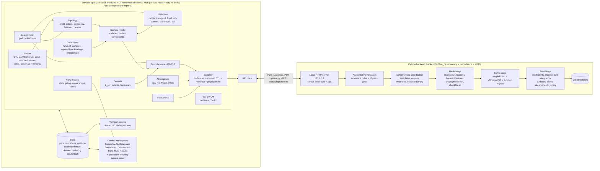
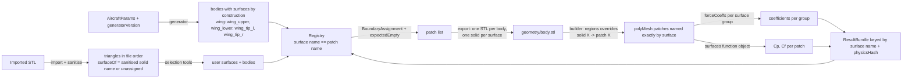

# Revised System Architecture

Status: **v1.0**, revised after the adversarial review (2026-10-23). Every change made because of an objection is traced in [ADVERSARIAL_PLAN_REVIEW.md](../audits/ADVERSARIAL_PLAN_REVIEW.md).

Related documents:
- `DEC-xx` decisions are in [MASTER_REVISED_PROJECT_PLAN.md](../plans/MASTER_REVISED_PROJECT_PLAN.md).
- Normative schemas and formulas are in [DATA_CONTRACTS_AND_PIPELINE.md](DATA_CONTRACTS_AND_PIPELINE.md). That document wins any conflict.

## 1. Design principles

Each principle is derived from the root causes RC-1..RC-6 in the [discrepancy register](../audits/DISCREPANCY_REGISTER.md) §2.

1. **Identity by construction, not by inference (RC-1).**
   - **Imported meshes.** Each triangle has a stable `triangleId` (its file order) and belongs to exactly one surface.
   - **Generated geometry.** Surfaces are assigned by the generator and identified by **name only**. Generated triangles are never tagged individually (RA-06).
   - Each surface name is OpenFOAM-safe and becomes the patch name unchanged. The case builder enforces this with explicit `regions` overrides (RA-01).
2. **One canonical topology (RC-2).** A single weld produces an indexed mesh, an edge map, adjacency and feature edges. One spatial index (RA-12) serves every geometric query.
3. **Fail closed, with provenance (RC-3).**
   - Every derived quantity is a record: `{value, units, inputsHash, validity: ok|warning|error, messages[], source}`.
   - Invalid input yields "not available" with reasons.
   - Stale results are visibly stale.
   - The backend is the authority on validity. Browser validation gives immediate feedback (RA-14).
4. **Independent oracles for every method (RC-4).** A self-consistency test is never sufficient.
5. **Pure core, thin UI (RC-5).**
   - `src/core/**`, `src/geometry/**`, `src/domain/**` and `src/export/**` import nothing but relative modules. They contain **no bare specifiers, no DOM and no three.js** (RA-20), so they run unchanged in Node tests, the browser and workers.
   - UI rules (staleness, colour maps, labels, plot-point filtering) are **pure view-model functions** with unit tests (RA-08).
6. **Heavy and physical computation runs server-side with pinned tools (RC-6).** The browser never fabricates or interpolates CFD quantities.

## 2. Subsystems



## 3. Subsystem contracts

| Subsystem | Owns | Produces | Validation point (fails closed) |
|---|---|---|---|
| Import (`src/core/import.js`, `src/stlParser.js`) | Source bytes, units, axis map | `SurfaceMesh` in file order. ASCII `solid` names become provisional surfaces after sanitisation (DATA_CONTRACTS §4.3). | Non-finite vertices; axis map with det = −1 (winding flipped and recorded); empty or truncated file |
| Generators (`src/geometry/*`) | `AircraftParams` | One **body** per part: closed, with named surfaces. `generatorVersion`. | Closed, 2-manifold, no self-intersection, outward (GEO-T2) |
| Topology (`src/core/topology.js`) | Weld, edges, CSR adjacency, features | `Topology`, cached by mesh identity | Open, non-manifold and degenerate counts, per surface and per body |
| Spatial index (`src/core/spatial.js`) | Grid and AABB tree | Ray, nearest-point, box, triangle–triangle and inside queries | Unit tests against brute force |
| Surface model (`src/core/surfaceModel.js`) | `surfaceOf` (imported only), registry of **surfaces, bodies, components** | Named surfaces; bodies (closed shells, the export unit); components (semantic groups) | Total, unique mapping; names valid and unique case-insensitively; every body closed before export (R6) |
| Selection (`src/core/selection.js`) | Ephemeral selection | Triangle sets → surface operations (imported meshes only) | Pick identity (SEL-T1); barriers respected |
| Domain, boundaries (`src/domain/*`) | Domain parameters, `BoundaryAssignment` | Patch list with BC types; `expectedEmpty` | Rules R1-R10 |
| Atmosphere (`src/core/atmosphere.js`) | Flow inputs | Re, M, k∞, ω∞ | M > 0.3 is an error; low-Re warning |
| Exporter (`src/export/caseExport.js`) | — | Manifest + one STL per body + `physicsHash` | Schema, rules, closure; refuses on any error |
| Tier-0 VLM (`src/vlmSolver.js`) | — | C_L, C_Di (Trefftz), C_m, x_NP with validity | Resolution check (R1 vs R2) |
| View models (`src/core/viewModels.js`) | — | Display-ready values, states and labels | Unit tested (RA-08) |
| Store (`src/state/store.js`) | Persistent project state | Snapshots (async hashing), gesture-coalesced undo | Schema `airflow.browser-project` v2 with migration from v1 |
| Viewport (`src/view/*`) | GPU resources only | Pixels, pick rays | Degraded mode without WebGL |
| Backend (`backend/airflow_case`) | Job directories | ResultBundle + binary fields | Authoritative re-validation, version pin, mesh/convergence gates, cross-checks |

## 4. State ownership

| Slice | Persistent | Notes |
|---|---|---|
| `project` (schema `airflow.browser-project`, version 2, appVersion) | yes | The existing schema id is kept (RA-21) |
| `source` | yes | **Imported:** `{kind:"imported", name, meshHash, unitScale, axisMap, det}`. **Generated:** `{kind:"generated", paramsHash, generatorVersion}` (RA-06, RA-10). |
| `aircraftParams` | yes | Generated only |
| `surfaces` | yes | **Imported:** RLE of `surfaceOf` over `triangleId`, plus the registry. **Generated:** registry overrides only (surface renames and BC tags keyed by generator surface name). Never triangle-level. |
| `bodies`, `components` | yes | Bodies are closed shells; components are semantic groups |
| `boundary`, `domain`, `flow`, `reference`, `solverSettings`, `mass` | yes | Every reference value carries `source: derived\|user` |
| `jobs` | yes | `jobId`, `physicsHash`, status |
| `results` | cache | Keyed by `physicsHash`. Stale when it differs from the current export's `physicsHash`. |
| `selection`, `hover`, `camera`, `activeWorkspace` | no | UI-only |
| `topology`, `meshProperties`, `vlm` | cache | Keyed by `inputsHash` |

**Hashes (RA-11).**
- **`inputsHash`:** a cheap, synchronous hash (FNV-1a over a canonical JSON of the relevant slices plus `meshHash`/`paramsHash`). Used for live staleness.
- **`physicsHash`:** SHA-256 at export time over the canonical physics content of the manifest and every body file hash.
- **Provenance:** recorded alongside; excluded from both hashes.

**Undo.** Surface, boundary and parameter operations form a journal. Each continuous gesture (a slider drag, a flood selection) coalesces into one entry. Depth is 100. Selection is not undoable. Parameter undo is deferred to M7 (RA-22).

## 5. The identity chain



**Invariants**, each with its enforcing test:

1. **Imported meshes:** the triangle → surface map is total and unique (SURF-T1).
2. **Pick → `triangleId` is exact** for 1,000 random rays, with or without a BVH (SEL-T1).
3. **`patchNameOf(body, surface) = surface`.** The patches in `constant/polyMesh/boundary` equal the manifest surfaces, minus `expectedEmpty`, plus the domain faces (MESH-T3). The builder achieves this with per-region `name` overrides, verified on the pinned version (CFD-T1).
4. **Every exported body is closed** (R6, EXP-T1, EXP-T5).
5. Every result carries the **`physicsHash`** of the exact manifest and body files that produced it (CFD-T6).

Triangle ids never survive meshing. After meshing, identity is the surface (patch) name only.

## 6. Watertightness and union strategy (DEC-06)

- **The CFD path uses no Boolean union.**
  - Each generated part is exported as a closed **body**.
  - snappyHexMesh discards cells inside any closed body.
  - Intersection curves come from `surfaceBooleanFeatures` per intersecting body pair.
  - Surfaces buried inside another body (wing root caps, fin roots) are expected to produce no faces and are listed in `expectedEmpty`.
- **Junction quality is a known risk** (see the B-review dispositions in [ADVERSARIAL_PLAN_REVIEW.md](../audits/ADVERSARIAL_PLAN_REVIEW.md) §2). It is measured by spike S-4 in M4b: overlapping bodies plus Boolean features, compared with a Manifold-unioned shell.
- **An imported fused shell** is one body with many surfaces. If it is not closed (the demo A320 has 28 open edges), the backend attempts a reported repair, and the export fails closed if closure is not achieved.
- **Manifold** (provenance-preserving union) is the only union candidate (spike S-3). **three-bvh-csg is rejected** for export (DR-14).

## 7. Viewport architecture

- **Renderer.** One renderer, created lazily, with render on demand. A failure gives `viewport.status = unavailable`; analysis and plots still work.
- **Render geometry.** Non-indexed, with per-triangle colour and the `#FF6600` highlight.
- **Partial updates.** Selected ids are coalesced into contiguous runs. Above 64 runs, the whole attribute is uploaded (RA-19; r160 issues one `bufferSubData` per range).
- **Picking.**
  - Brute force by default; three-mesh-bvh only per spike S-2.
  - Identity always goes through `triangleIdOfRenderFace`.
  - The viewport imports `three` through a **single import map** entry pointing to `/vendor/three/three.module.js`, with no query strings, so there is one module instance (RA-20, DR-38).
- **Lifecycle.** Dispose on replacement; a context-loss handler; pan, zoom-to-cursor and fit-to-selection.

## 8. Backend architecture (DEC-08, DEC-09)

```
backend/
  pyproject.toml            # python >= 3.11 (host 3.14.6); deps: numpy, jsonschema; stdlib http.server/json/hashlib/subprocess
  airflow_case/
    cli.py                  # validate | estimate | build | mesh | solve | post | run | serve
    server.py               # 127.0.0.1 only: static app + /api (POST /api/jobs, PUT /api/jobs/{id}/geometry/{body}.stl,
                            #   GET /api/jobs/{id}/status|log/{stage}|result.json|fields/{file}, POST /api/estimate)
    manifest.py             # jsonschema + rules R1-R10 + physics gates (authoritative)
    names.py                # name validation (shared regex), never trusts client paths
    foam_version.py         # pinned version check; region-override behaviour probe
    templates/              # versioned dict templates (values interpolated only after validation)
    build.py                # deterministic case dir, regions overrides, expectedEmpty, locationInMesh
    mesh.py                 # stages + checkMesh parse -> MeshReport
    solve.py                # per-alpha U rotation, function objects, convergence gate
    post.py                 # forceCoeffs/forces parse; numpy integration of p and wallShearStress from function-object output;
                            #   surfaces/slices/streamlines -> aligned binary
    results.py              # ResultBundle writer (schema-validated)
  tests/                    # pure tests + `-m openfoam` integration tests
schemas/                    # single source of truth for JSON Schemas (browser imports a generated JS copy checked by a test)
validation/                 # NACA 0012 2D, rectangular wing 3D, REPORT.md (M6)
```

- **Job directory** `jobs/<jobId>/` contains:
  - `input/`: immutable manifest and bodies
  - `case/`
  - `logs/<stage>.log`
  - `result/`
  - `status.json`, recording the state, stage timings and a failure reason from a fixed taxonomy
- **Security.** The server binds 127.0.0.1 only. Names are regex-validated before they reach any path or dictionary. Requests never carry paths. Upload size is limited.
- **No silent fallbacks.** Every gate failure is a `failed` state with a specific reason.
- **Reproducibility.** The record includes the OpenFOAM version string, template version, `physicsHash`, git commit (read by the backend), CPU count and decomposition.

## 9. Browser vs backend

| Function | Where | Reason |
|---|---|---|
| Generators, topology, spatial queries, surfaces, BCs, domain preview, manifest | Browser (pure core) | Interactive; testable in Node |
| Tier-0 VLM | Browser (main thread now; worker in M7) | Fast linear-range cross-check |
| Authoritative validation, cell estimate | Backend | One source of truth (RA-14) |
| Meshing, solving, force extraction, field reduction, streamlines | Backend | OpenFOAM |
| Surface C_p/C_f, slices, polylines display | Browser | From aligned binary files |
