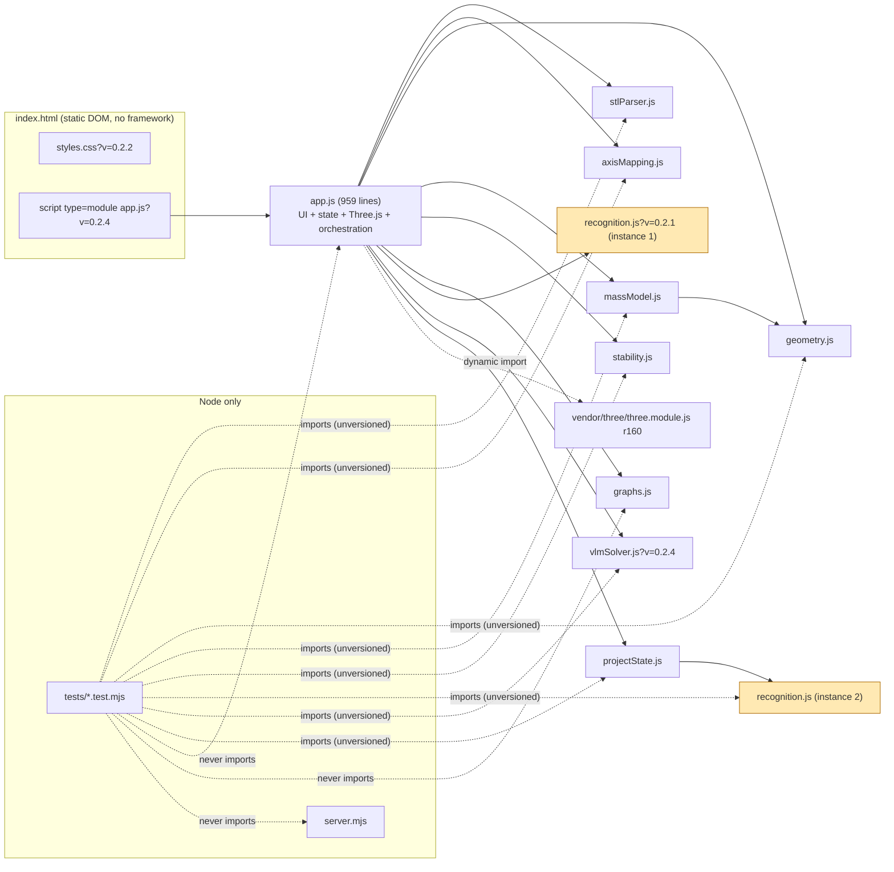
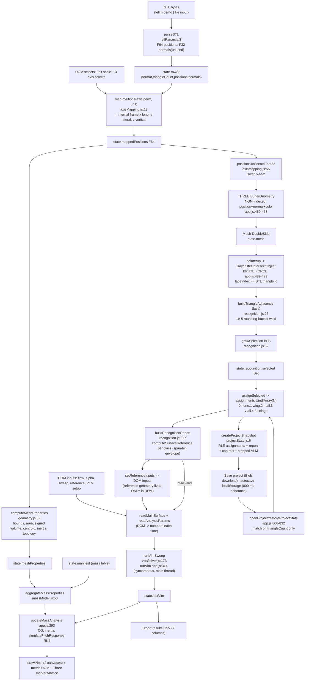

Status: **Evidence record**. This is the Phase-1 audit by Subagent A (Sonnet 5.5).

The coordinator independently confirmed these findings on 2026-10-23:
- A-SEL-01, A-SEL-02, A-SEL-03, A-SEL-11
- A-GEO-01 (exact-weld topology 28/5/0)
- A-LIFE-02 (observed in the built-in browser)
- A-REPO-01

See [DISCREPANCY_REGISTER.md](DISCREPANCY_REGISTER.md) §1. The register consolidates every finding into `DR-xx` entries with dispositions. **Use the register for decisions; use this file for evidence.**

# AirFLOW Repository Implementation Audit

Auditor: Subagent A, running as Sonnet 5.5 (`claude-sonnet-5-5`). Date of audit: 2026-10-23.
Companion document: `docs/audits/UI_AND_SELECTION_AUDIT.md` (UI layout and the full geometry -> selection -> persistence trace; findings `A-SEL-*`, `A-UI-*`, `A-LIB-*`).

## 0. Scope, method and evidence conventions

Goal: reconstruct what the software in `/home/tanvir/Coding/AirFLOW` actually does, independent of the requirements/CFD-math audit.

Evidence tags used on every statement that matters:

| Tag | Meaning |
| --- | --- |
| `[N]` | Executed in Node 24.21.0 by a throwaway script under `/tmp/claude-1000/-home-tanvir-Coding-AirFLOW/76bf9998-d405-4391-a3a5-0698b59e1664/scratchpad/auditA/` that imports the real `src/` modules. Output quoted is real. |
| `[B]` | Executed in the real Claude desktop browser pane against a scratchpad copy of the app (the "harness", see 0.1). |
| `[S]` | Static reading of source (file:line). Not executed. |
| `[W]` | Web / npm-registry documentation (fetched 2026-10-23). |

### 0.1 Important environment limitation (read this)

The built-in browser pane has no GPU. Loading the unmodified app at `http://127.0.0.1:4189/` produced `THREE.WebGLRenderer: Error creating WebGL context` (see A-LIFE-02), so the real viewport could not be exercised and no real rendered frame was seen. To still exercise the app's real DOM/state/event logic in a real browser event loop I built a scratchpad harness:

- `scratchpad/auditA/harness/` is a COPY of `index.html`, `server.mjs`, `src/`, `vendor/three/` plus a symlink to the demo STL.
- Only two edits exist in the copy: `THREE_LOCAL` in `harness/src/app.js` now points at `./three_stub.js`, and one line `window.__state = state; ...` was added so the page can be inspected. `three_stub.js` re-exports the real three.js r160 and replaces only `WebGLRenderer` with a no-GPU stub (it updates `scene`/`camera` matrices exactly as the real renderer does, then counts frames).
- Consequence: everything about picking math, raycasting (real three.js `Mesh.raycast`), region growth, recognition, VLM, plots (real 2D canvas), project save/load logic, autosave (real localStorage) is real. Pixels drawn by WebGL and GPU timings are NOT observed.
- The repository was not modified: `git status --short` before and after shows only `?? refs/` (plus the two new docs under `docs/audits/`).

Servers I started were on ports 4189 and 4190 (not 4173) and were stopped at the end.

## 1. Executive summary of the actual system

AirFLOW is a dependency-free, single-page browser MVP of 3,649 lines (`src/` 2,993 incl. CSS, tests 408, `index.html` 162, `server.mjs` 76, `package.json` 10): static HTML + vanilla ES modules, served by a 76-line Node static file server, with a vendored three.js r160 (`vendor/three/three.module.js`, single file, no addons). There is no React, no Zustand/Redux, no Tailwind, no bundler, no backend, no TypeScript, no Vite, no OrbitControls, no three-mesh-bvh, no three-bvh-csg, no CSG, no meshing, no OpenFOAM/Gmsh, no VTK reader.

What it does end-to-end: loads a binary/ASCII STL (default: the 9.5 MB A320 demo, 197,772 triangles), applies a unit scale and axis permutation, computes bounds/area/signed-volume/centroid/inertia/topology counts, renders it as a flat-shaded non-indexed `BufferGeometry` with per-triangle vertex colours, lets the user click triangles (brute-force raycast), grow a region by normal angle (BFS over a lazily built edge-adjacency graph), assign selections to one of four labels (wing / H-tail / V-tail / fuselage) stored as a `Uint8Array(triangleCount)`, derives a planform reference (span, area, MAC, chords, sweep, dihedral) from the assigned wing triangles via a span-bin envelope, runs a one-chordwise-row horseshoe VLM alpha sweep, aggregates a one-line mass manifest, computes a linearised pitch response, draws plots on two 2D canvases, and exports project JSON / results CSV.

Top findings (full register in section 8 and in the companion doc):

| ID | Severity | One-line |
| --- | --- | --- |
| A-SEL-02 | High | Project fingerprint is `triangleCount` only; a project from a different file is accepted and its unit/axis metadata is ignored, producing nonsense that still runs the VLM (`[B]`). |
| A-SEL-11 | High | Partial or absurd wing selections are accepted as "Recognized wing" and flow into VLM with no sanity check (`[B]` MAC 21.7 m, root chord 32.4 m, span 17.2 m for a 34 m aircraft). |
| A-SEL-07 | High (MISSING) | No persistent surface/region/patch model, no boundary tags, no patch export; the whole selection model is 4 enum labels per triangle. |
| A-LIB-02 | High (hazard) | Adding three-mesh-bvh with default options would create/reorder an index and break the `faceIndex == STL triangle id` invariant the whole persistence layer relies on. |
| A-ARCH-01 | High (requirement conflict) | The brief's "React/Three.js lifecycle" does not exist; there is a one-shot imperative vanilla lifecycle with no teardown path. |
| A-FLOW-01 | Medium | After any input change the plots keep showing the previous run (`[B]` identical canvas pixel hashes while badge says "Inputs changed"). |
| A-FLOW-05 | Medium | If the alpha window does not contain +-5 deg, `CL_alpha=0`, static margin NaN, and the UI says "Unstable" (`[N]`). |
| A-GEO-01 | Medium | Topology counts are inflated by degenerate-triangle self-edges; the demo regression test pins the inflated numbers (8 boundary / 85 non-manifold; with exact weld the mesh has 28 / 5). |
| A-LIFE-02 | Medium | A WebGL failure kills the whole app, including the pure-computation analysis, with a misleading error (`[B]`). |
| A-SRV-01 | Low | `server.mjs` process dies on a malformed percent-escape URL (`[N]`). |

## 2. Repository organisation and build/serve model

### 2.1 File inventory `[S]` + `wc`

```
index.html            162 lines   static DOM, 3-column shell
server.mjs             76         node:http static server, 127.0.0.1:${PORT||4173}, +1 port retry x12
package.json           10         scripts: start, test only; "type":"module"; zero dependencies
src/app.js            959         UI + state + Three.js viewport + picking + orchestration + persistence glue
src/recognition.js    341         adjacency, region growth, assignments, planform reference, RLE
src/geometry.js       294         bounds, area, volume/centroid/inertia, topology
src/vlmSolver.js      311         horseshoe VLM
src/styles.css        456
src/massModel.js      144         one-line manifest, CG/inertia aggregation
src/stability.js      116         pitch RK4 + (unused) computeStaticStability + bounds seed
src/graphs.js         137         2D canvas plotting
src/stlParser.js       98
src/projectState.js    74
src/axisMapping.js     63
tests/*.test.mjs      23 tests / 7 files + fixtures.mjs
vendor/three/three.module.js   r160 (REVISION '160'), 1,272,972 bytes; no OrbitControls, no BufferGeometryUtils, no BVH
assets/airbus-a320-cfd-1.snapshot.7/samolot.stl  9,888,684 bytes (+ 9 PNGs)
refs/                 untracked requirement material (2 .md)
reference/xflr5       git gitlink (mode 160000) with no .gitmodules entry and an empty directory (see A-REPO-01)
plan.md, MVP_METHODOLOGY.md, CALCULATION_PIPELINE.md   documentation
```

`package.json` has no `dependencies`, no `devDependencies`, no lockfile. `node_modules/` does not exist. `.gitignore` is generic (node, logs, OS files).

### 2.2 Serve model

- `npm start` -> `node server.mjs`. Static server: `Cache-Control: no-store` on every response (`server.mjs:48-52`), MIME map for html/js/mjs/css/json/stl/png/svg/wasm, listens on `127.0.0.1` only (`server.mjs:70`), tries 12 successive ports on `EADDRINUSE`.
- Verified `[N]` with `curl` against a second instance on port 4189: all of `/`, `/src/*.js`, `/vendor/three/three.module.js`, the STL return 200 with the expected content types; unknown path and `..%2f` traversal attempts return 404.
- No build step. Nothing is transpiled or bundled.

### 2.3 How `index.html` loads code `[S]` + `[B]` network log

`index.html:7` stylesheet `./src/styles.css?v=0.2.2`; `index.html:160` `<script type="module" src="./src/app.js?v=0.2.4">`. No import map. `app.js` statically imports 9 sibling modules (`app.js:1-30`) and dynamically imports three at runtime: `state.THREE = await import(THREE_LOCAL)` (`app.js:90`, `THREE_LOCAL = "../vendor/three/three.module.js"`, `app.js:33`). three.js is therefore a dynamic, un-mapped, relative import; it resolves to `/vendor/three/three.module.js`.

Real browser network log (`[B]`, `read_network_requests`, unmodified app at :4189):

```
GET /src/styles.css?v=0.2.2
GET /src/app.js?v=0.2.4
GET /src/stlParser.js
GET /src/axisMapping.js
GET /src/geometry.js
GET /src/massModel.js
GET /src/stability.js
GET /src/graphs.js
GET /src/recognition.js?v=0.2.1      <-- instance 1
GET /src/vlmSolver.js?v=0.2.4
GET /src/projectState.js
GET /src/recognition.js              <-- instance 2 (imported by projectState.js:1 without the query)
GET /vendor/three/three.module.js
```

### 2.4 Cache-busting query strings and duplicate module instances (A-ARCH-03, A-ARCH-04)

- **A-ARCH-03 | VERIFIED DEFECT | Low.** `src/recognition.js` is evaluated twice in the browser: once as `./recognition.js?v=0.2.1` (`app.js:22`) and once as `./recognition.js` (`projectState.js:1`). Browser module maps are keyed by full URL, so these are two distinct module instances (confirmed by the two requests above `[B]`). Today `recognition.js` has no mutable module-level state (only frozen constants and pure functions), so the duplication is benign: `encodeAssignments`/`decodeAssignments` are pure. Consequence: the day any module gains state (a store, a cache, a registry) or when three.js/three-mesh-bvh gets a `?v=` suffix on one import path, you get silent split-brain or a "multiple instances of Three.js" failure (`instanceof` checks fail across instances). Reproduce: open the network log; or `grep -n "recognition.js" src/*.js`.
- **A-ARCH-04 | VERIFIED DEFECT | Low.** The version strings are manual, inconsistent (`styles 0.2.2`, `app 0.2.4`, `recognition 0.2.1`, `vlmSolver 0.2.4`; all other modules unversioned) and pointless because the server sends `no-store`. The tests import unversioned paths, so the test environment is not the shipped URL graph.
- `app.js` itself is imported by nothing (entry point), so `app.js?v=0.2.4` cannot duplicate.
- `geometry.js` is imported by `app.js` and `massModel.js` with the same URL: single instance.

## 3. Module map and dependency graph



Leaf modules (no imports): `stlParser`, `axisMapping`, `geometry`, `stability`, `graphs`, `vlmSolver`, `recognition`. There are no import cycles.

## 4. End-to-end data flow (CURRENT system)



### 4.1 State ownership `[S]`

- One module-private mutable object `state` (`app.js:55-82`): raw STL, mapped positions, mesh properties, manifest, recognition model (`{assignments: Uint8Array, selected: Set}`), recognition report, adjacency, axis mapping, unit scale, reference source tag, Three objects, orbit controller, `lastVlm`, `lastPitchSamples`, `lastMassProperties`, `pendingProject`, autosave timer.
- The DOM is a second, authoritative source of state: the reference lifting surface (area/span/MAC/chords/sweep/dihedral/incidence/root x), flow conditions, alpha sweep, VLM setup and region-growth parameters exist ONLY as `<input>` values and are re-read with `readAnalysisParams()`/`readMainSurface()` (`app.js:355-385`) every time (`CONTROL_IDS`, `app.js:34-39`, is the persistence list). There is no model object for "reference geometry".
- `state` is not exposed (module scope): nothing outside `app.js` can read it (the harness had to inject `window.__state`).
- No event bus, no observers: `app.js` calls `renderX()`/`invalidateVlm()`/`updateMassAnalysis()` imperatively from each handler.

### 4.2 What recomputes when inputs change `[S]`, confirmed `[B]`

| Trigger | Recomputed | Not recomputed / stale |
| --- | --- | --- |
| Load/import STL (`loadStlBuffer` `app.js:205`) | parse, `mapPositions`, `computeMeshProperties` (~0.45-0.8 s sync), geometry rebuild, report, `invalidateVlm`, mass analysis, then `runVlm()` | recognition model kept if triangle count equal (A-FLOW-04); axis/unit selects kept; manifest reset to 42,600 kg default |
| Unit/axis select change (`remapCurrentGeometry(true)`) | mapped positions, mesh properties, report, **reference DOM inputs overwritten** (A-FLOW-02), geometry rebuilt, `invalidateVlm`, then `runVlm()` | `selected` set kept; `adjacency=null` (rebuilt on next pick); manifest point-mass positions transformed |
| Any solver/reference/flow input (`input` event) | `invalidateVlm`, `updateMassAnalysis`, debounced autosave | VLM NOT re-run (manual); plots NOT cleared (A-FLOW-01); `neutralPointInput`/`aeroCenterInput` keep old values |
| Mass table edit | `invalidateVlm`, `updateMassAnalysis` | `massKg` text that parses to NaN silently becomes 0 (`app.js:661`) |
| Assign / Clear assignments | report, reference inputs (may overwrite user edits), colours, `invalidateVlm`, mass analysis; Assign auto-runs VLM if wing valid, Clear does not | |
| Open project (demo name) | full demo reload with project axis/units, assignments restored | |
| Open project (other name, same triangle count) | assignments + controls + manifest restored | project's axis mapping / unit scale NOT applied (A-SEL-02) |
| Autosave | `scheduleAutosave` after most edits | silent restore at boot for demo only (A-FLOW-03) |

## 5. Implementation status (against the MVP docs AND the refs requirements)

Legend: IMPLEMENTED (works, evidence), PARTIAL, STUBBED (code exists but not reachable from UI), DISCONNECTED (exists, not wired), MISSING. "Planned" is never counted as implemented.

| Capability | MVP docs claim | refs/CFD requirement | Actual status | Evidence |
| --- | --- | --- | --- | --- |
| STL import binary+ASCII | FS-02 yes | implied | IMPLEMENTED with edge-case defects | `stlParser.js`; A-GEO-02 |
| Units + axis mapping | yes | implied | IMPLEMENTED; positive-path barely tested | `axisMapping.js`; tests only test rejection |
| Triangle ids by index | yes | `faceIndex` selection | IMPLEMENTED (index == STL order, non-indexed render geometry) | `[N][B]` `geometry.index === null`, 593,316 vertices = 3 x 197,772 |
| Mesh topology/volume/inertia | FS-03 yes | -- | IMPLEMENTED; counts inflated | A-GEO-01 |
| three-mesh-bvh / `computeBoundsTree` | not claimed | REQUIRED (3.1) | MISSING (brute-force `Mesh.raycast`, `vendor/three` has no BVH) | `three.module.js:11840-11880`; A-SEL-08 |
| Ctrl+Click single face | n/a | REQUIRED | PARTIAL: plain click selects (region-grow off => 1 triangle); Ctrl = XOR toggle | `app.js:514-518`; A-SEL-04 |
| Ctrl+Shift+Click BFS flood fill, <=30 deg dihedral | n/a | REQUIRED | PARTIAL/DIFFERENT: BFS exists behind a checkbox, default 18 deg, double criterion (local + seed normal), cap 15,000; no Shift handling | `recognition.js:62-95`; A-SEL-03/12 |
| Highlight by editing vertex-colour attribute, #FF6600 | n/a | REQUIRED | PARTIAL: in-place vertex colour update (correct, no bleed), colour is (1,0.78,0.08) not #FF6600; full-buffer rewrite+upload per update | `app.js:470-487`; A-SEL-09 |
| Manual component labels | FS-04 yes | REQUIRED | IMPLEMENTED for 4 labels only | `recognition.js:3-9` |
| Boundary tags (VELOCITY_INLET etc.) + JSON manifest | n/a | REQUIRED | MISSING | grep: no tags anywhere |
| Selection inspection (properties of selection) | partial | REQUIRED | PARTIAL: count + (wing) span/area only | `app.js:543-555` |
| Undo/redo | deferred | -- | MISSING | MVP doc "Deferred" |
| Parametric wing (NACA 4-digit, twist/dihedral/sweep/taper) | n/a | REQUIRED | MISSING | no NACA code |
| Superellipse fuselage generator | n/a | REQUIRED | MISSING | |
| Tail assemblies (conventional/T/V/H/inverted-U) | n/a | REQUIRED | MISSING | |
| Fluid domain 3L/6L enclosure | n/a | REQUIRED | MISSING | |
| CSG union (three-bvh-csg) -> watertight shell | n/a | REQUIRED | MISSING | A-LIB-03 |
| Binary STL export | partial (`serializeBinarySTL`) | REQUIRED | STUBBED: exists in `stlParser.js:64`, used only by tests, no UI | `grep serializeBinarySTL` |
| Multi-solid / patch export | n/a | implied by BC tags | MISSING (A-SEL-07) | |
| Backend (Node/Python), Gmsh/snappyHexMesh, simpleFoam k-omega SST | n/a | REQUIRED | MISSING | no backend, no solver install |
| VTK/JSON results import, Cp contours, streamlines | n/a | REQUIRED | MISSING | |
| CL, CDi, Cm vs alpha, static margin, neutral point | FS-05 yes | partial | IMPLEMENTED (VLM, one chordwise row); fragile outside +-5 deg window | A-FLOW-05 |
| CD (total) | CD0 constant + CDi | CFD CD | PARTIAL: `CD = CDi + user CD0` | `vlmSolver.js:191` |
| CL,max | no | REQUIRED | MISSING | grep: no `clmax`/stall model |
| Reynolds number | no | REQUIRED | MISSING | grep: no `reynolds` in src |
| Pitch response | yes | -- | IMPLEMENTED (linearised RK4 demonstrator) | `stability.js:38` |
| `computeStaticStability` | in tests | -- | DISCONNECTED: only tests call it; app uses VLM-derived margin | `grep` |
| Project JSON save/open, autosave | FS-01 yes | -- | IMPLEMENTED; weak fingerprint, silent restore | A-SEL-01/02, A-FLOW-03 |
| Results CSV | FS-07 yes | -- | IMPLEMENTED (CL, CDi, CD, Cm, lift, drag, moment) | `app.js:839-847` |
| React + Tailwind | n/a | LATER priority, REQUIRED | MISSING | no JSX/TS/Vite/Tailwind files (`find`) |
| Zustand/Redux store | n/a | REQUIRED (8.2) | MISSING (single `state` object + DOM) | A-ARCH-02 |
| Model tree / properties inspector / tabs | n/a | REQUIRED (8.1/8.3/9) | MISSING; 3 fixed columns, no tabs | UI doc |
| Separate geometry/tagging/domain/solver/results contexts | n/a | REQUIRED | MISSING (one scrolling left panel; domain context absent) | UI doc |
| "FlowSync v2" React/TS codebase (Qwen handoff) | n/a | n/a | NOT IN THIS REPO (A-DOC-01) | no `*.ts(x)`, no Vite config |

## 6. What "React/Three.js lifecycle" means for THIS repo (A-ARCH-01)

**A-ARCH-01 | MISSING (requirement conflict) | High.** The task brief refers to a "React/Three.js lifecycle". There is no React. The actual lifecycle is:

1. Parse `index.html` (all DOM static) -> evaluate `app.js` -> `initAxisControls(); bindEvents(); bootstrap()` (`app.js:84-86`).
2. `bootstrap()` (`app.js:88-98`): dynamic-import three, `initViewer()` (scene, camera, renderer, lights, grid, three groups, orbit, two `ResizeObserver`s, `animate()`), then `loadDemo()`.
3. From then on all behaviour is event-driven imperative mutation of module-level `state`, the DOM and one `THREE.Mesh`.
4. There is NO teardown: `animate()` re-schedules itself with `requestAnimationFrame` and never stores the id (`app.js:640-644`), `ResizeObserver`s are never disconnected (`app.js:407-408`), `window`/canvas listeners are never removed, `renderer.dispose()`/`forceContextLoss()` is never called, there is no `webglcontextlost` handler.

Consequences if this code were ported into a React component as-is: a StrictMode double-mount would create two renderers/canvases and two uncancellable render loops (`bootstrap()` and `initViewer()` are not idempotent); an unmount cannot stop the loop; observers and `window` listeners would leak. There is no component boundary to hang `useEffect` cleanup on: viewport, picking, recognition UI and results are all closures over the one `state`. Any React migration needs an explicit viewport object with `init()/dispose()`, an `AbortController` for listeners, and a store that owns what is currently split between `state` and DOM inputs. None of that exists today; it must not be assumed.

## 7. Three.js lifecycle and performance (measured)

All numbers: demo STL, 197,772 triangles. `[N]` = Node/V8 with the real three.js r160 module; `[B]` = real browser pane + harness.

### 7.1 Setup, render loop, resize, controls `[S]`

- Renderer: `new WebGLRenderer({ antialias: true, preserveDrawingBuffer: true })` (`app.js:392`), `setPixelRatio(min(dpr,2))`. `preserveDrawingBuffer: true` forces the backbuffer to be retained every frame (only needed for screenshots/readPixels); A-LIFE-03.
- Camera: `PerspectiveCamera(45, 1, 0.01, 100000)`; near/far recomputed from orbit radius on every camera update (`app.js:625-626`).
- Controls: hand-written `createOrbitController` (`app.js:413-450`): rotate by pointer drag, wheel zoom about the fixed target (bounds centre), **no pan**, no touch gestures, no damping. Selection mode disables rotation (`app.js:420`).
- Render loop: `animate()` renders EVERY animation frame forever (`app.js:640-644`); no dirty flag, no on-demand rendering, no pause. `[B]` the stub renderer counted 1,091 `render()` calls roughly 10 s after the first harness load while the pane was visible (continuous loop; exact elapsed time not recorded). Later, with the pane throttled, only 1 frame had run (see A-LIFE-06).
- Resize: `ResizeObserver` on `#viewer` -> `resizeViewer()` and `window.resize` -> `resizeViewer()+updateGraphs()` (redundant double handling); a second `ResizeObserver` on the results panel redraws plots.
- Scene content: HemisphereLight + DirectionalLight, `GridHelper(80,40)` and `AxesHelper(8)` at fixed sizes irrespective of model size, three groups (mesh, VLM lattice, markers).

### 7.2 Geometry construction and disposal `[S][N][B]`

- `renderMesh()` (`app.js:452-468`): positions via `positionsToSceneFloat32` (Float32 copy, y/z swapped), a zero-filled `color` attribute, `computeVertexNormals()` (non-indexed => flat, per-triangle normals; `[N]` 0 of the first 20,000 triangles have non-flat normals), `MeshStandardMaterial({vertexColors:true, side:DoubleSide})`. `geometry.index === null` (`[N]` and `[B]`), `position.count = 593,316`.
- Re-import: the previous `mesh.geometry.dispose()` and `mesh.material.dispose()` are called before the new mesh is added (`app.js:453-457`) => no GPU geometry leak for the main mesh. `[B]` after a second "Load demo": `meshGroup.children.length === 1`, `geometry.uuid` changed.
- `clearGroup()` (`app.js:925-934`) disposes `child.geometry` and `child.material`. `ArrowHelper` objects (3 per `updateSceneAnnotations`, `app.js:599-603`) are `Object3D`s whose geometry/material live on their `.line`/`.cone` children, so their per-arrow materials are never disposed (A-LIFE-04). In r160 the arrow geometries are shared module-level statics (`three.module.js:52577-52605`), so only JS materials/program references are involved, not unbounded GPU buffers. Low.
- The renderer, scene, observers and listeners are never disposed (single-page app; see 6).

### 7.3 Picking cost `[N]` and `[B]`

| Measurement | Value |
| --- | --- |
| Raycast method | `Raycaster.intersectObject(mesh,false)` -> stock `Mesh.raycast` => bounding sphere test, then loop over every triangle (`three.module.js:11840-11880`); `geometry.boundingBox` stays `null` so only the sphere test is used. No BVH. |
| Per-ray cost, Node, warm, 30 screen positions | min 6.4, median 6.5, p90 7.8, max 7.9 ms |
| Miss (ray outside bounding sphere) | 0.01 ms |
| Hits per ray | 0 or 2 on the demo (front and back faces both returned because `DoubleSide`; sorted, `[0]` used) |
| `updateMeshColors` full pass (Node) | 5.5 ms; uploads `color.array.byteLength` = 7,119,792 bytes each time (no update range) |
| Whole warm pick in the real browser (`pointerup` -> raycast + region grow + colours + DOM) | 18.7 - 32.2 ms (5 samples: 32.2, 22.5, 19.2, 18.7, 24.0) `[B]` |
| FIRST pick in the real browser | **942 ms** `[B]`; it includes the lazy `buildTriangleAdjacency` (Node alone: 486.7 ms). The status text "Building triangle adjacency..." is set synchronously just before the blocking work, so it is never painted. |
| Adjacency rebuild | every unit/axis change sets `state.adjacency = null` (`app.js:234`), so the ~0.5-0.9 s stall recurs on the next pick after any remap |

Scaling risk: brute force is linear in triangles; at 2 M triangles expect ~65 ms per ray in Node (extrapolation, not measured). At the present 198 k it is acceptable; the stall is dominated by adjacency, not the ray.

### 7.4 Load pipeline timings `[N]` (`a1_pipeline.mjs`)

```
parseSTL: 16.2 ms
mapPositions: 39.0 ms
computeMeshProperties: 779.9 ms   (string-key welding; bounds+topology+mass props)
positionsToSceneFloat32: 4.4 ms
buildTriangleAdjacency: 486.7 ms  (second, independent string-key welding of the same mesh)
```

`[B]` whole "Load demo" click -> "VLM solved" took 793 ms wall-clock (fetch + parse + mesh properties + render + VLM), all on the main thread; the UI is frozen for the duration.

Duplicated work: `computeTopology` (`geometry.js:122`) and `buildTriangleAdjacency` (`recognition.js:26`) each re-weld all 593,316 vertices through `Math.round(v/tol)` + `join(",")` string keys and Map lookups. They should share one weld.

### 7.5 CPU memory `[N]` (`a11_memory.mjs`, `node --expose-gc`)

| Structure | Size |
| --- | --- |
| `rawStl.positions` Float64 | 13.6 MiB |
| `rawStl.normals` Float32 (never read by the app) | 6.8 MiB |
| `mappedPositions` Float64 | 13.6 MiB |
| Triangle adjacency (`Array` of 197,772 `Int32Array`) | 45.3 MiB |
| Subtotal | 79.3 MiB |
| Three.js CPU attribute copies (position/normal/color, 3 x 6.8) | 20.3 MiB |
| GPU copies of the same | ~20.3 MiB |

Non-indexed rendering stores 593,316 vertices although only 98,850 unique welded vertices exist (6x vertex duplication); acceptable here, but it is the reason the geometry is index-free and per-triangle colouring is trivially correct.

### 7.6 Other lifecycle observations

- **A-LIFE-01 | DESIGN RISK | Low.** Continuous render loop with no dirty flag, no cancel handle; power/battery cost for a static scene (`app.js:640`).
- **A-LIFE-02 | VERIFIED DEFECT | Medium.** WebGL creation failure is fatal for the entire app. `[B]` on the unmodified app: console `THREE.WebGLRenderer: Error creating WebGL context`, status line "Startup failed: Error creating WebGL context.", and the demo is never loaded because `bootstrap()` awaits `initViewer()` before `loadDemo()` (`app.js:90-93`) although parse/mass/VLM/plots need no GPU. Clicking "Load demo" afterwards yields the misleading "Geometry mapping failed: Cannot read properties of null (reading 'add')" (the `renderMesh()` call inside `remapCurrentGeometry` throws on `state.meshGroup` = null; the catch at `app.js:248-250` only sets the status and does not `console.error`), leaving state half-updated (`rawStl`, `mappedPositions`, `meshProperties`, `manifest` set; `lastMassProperties`, panels, VLM not), after which `runVlm()` silently returns (`app.js:315`). Consequence: any machine with WebGL disabled, a GPU blocklist or a lost context sees a dead app with a wrong error message; and any code path that touches `renderMesh` gates analysis on rendering.
- **A-LIFE-03 | DESIGN RISK | Low.** `preserveDrawingBuffer: true` has a per-frame cost and is unused (no screenshot code in `src/`).
- **A-LIFE-04 | VERIFIED (static) | Low.** `ArrowHelper` children are not disposed by `clearGroup`; `updateSceneAnnotations` rebuilds the marker sphere (geometry+material, 24x16 segments) and 3 arrows on EVERY `input` event of every solver/reference field and every mass edit (`app.js:171-176,310`).
- **A-LIFE-05 | MISSING | Medium.** No `webglcontextlost`/`restored` handling, no `dispose` path, no observer disconnect (see section 6).
- **A-LIFE-06 | DESIGN RISK | Low.** Picking uses `camera.matrixWorld`, which three.js only refreshes inside `renderer.render()`; `updateCameraFromOrbit()` (`app.js:615-628`) updates position/orientation but not `matrixWorld`. If rAF is throttled (background/occluded pane), clicks are cast through a stale camera. `[B]` observed: after the first harness load only 1 frame had run; `project()`ed screen coordinates were off-screen until I called `camera.updateMatrixWorld()`. Fix: call `camera.updateMatrixWorld()` before `setFromCamera`.
- **A-LIFE-07 | VERIFIED DEFECT | Medium.** All heavy work is synchronous on the UI thread: STL parse + mesh properties (0.5-0.8 s), adjacency (0.5-0.9 s), VLM (19 ms at defaults; 247 ms at 80 spanwise panels x 2 surfaces x 17 cases; **2,932 ms** at 160 panels x 161 cases `[N]` `a8_vlm_timing.mjs`), and nothing is run in a worker. The VLM alpha range/step inputs have no upper bound on case count (`vlmSolver.js:178-182` clamps step >= 0.1 only).

## 8. Findings register (this document)

Format: ID | category | severity. Evidence. Reproduction. Consequence. (A-SEL-*, A-UI-*, A-LIB-* are in the companion document; the summary table in section 1 cross-references them.)

### Architecture / repository

- **A-ARCH-01** (see section 6) MISSING, High.
- **A-ARCH-02 | DESIGN RISK | Medium. God module + DOM-as-state.** Evidence: `app.js` is 959 lines combining UI event wiring, viewport, picking, recognition UI, mass table, plots orchestration, project persistence and analysis orchestration (`app.js:84-959`); reference geometry and flow parameters exist only in DOM `<input>` values (`app.js:355-385`, `34-39`). Reproduction: `grep -c "elements\." src/app.js`. Consequence: nothing is unit-testable, no store to migrate to Zustand/Redux, the same data has to be threaded through `getElementById`, and persistence (`collectControlValues`, `app.js:864`) silently loses anything not in `CONTROL_IDS` (e.g. unit/axis are saved separately in `source`, see A-SEL-02).
- **A-ARCH-03, A-ARCH-04** (section 2.4) VERIFIED, Low.
- **A-ARCH-05 | VERIFIED DEFECT | Low. Dead / test-only code.** `computeStaticStability` (`stability.js:4-36`) is called only by `tests/massStability.test.mjs`; the app derives margin from the VLM instead, so the "static stability follows neutral point" test validates code the product never runs. `serializeBinarySTL` (`stlParser.js:64`) is used only by tests (no export UI). `parsed.normals` (6.8 MiB) is retained in `state.rawStl` and never read (`grep -n "\.normals" src` => only the parser). Reproduction: `grep -n "computeStaticStability\|serializeBinarySTL\|\.normals" src/*.js`.
- **A-REPO-01 | VERIFIED DEFECT | Low. Orphan gitlink.** `git ls-files -s reference/xflr5` => `160000 dc0c97faf6ea7d156758dce10274146cee455c1f 0 reference/xflr5`; `.gitmodules` does not exist; the working directory is empty; `git submodule status` => `fatal: no submodule mapping found in .gitmodules for path 'reference/xflr5'`. Consequence: `git submodule` commands error; `clone --recurse-submodules` of this repo will break; the referenced XFLR5 material is not actually present.

### Data flow / state

- **A-FLOW-01 | VERIFIED DEFECT | Medium. Stale plots after invalidation.** Evidence: `invalidateVlm()` (`app.js:898-907`) nulls `lastVlm`, clears the 3D lattice and the metrics panel but never clears the canvases; `updateGraphs()` returns early when `!state.lastVlm` (`app.js:770`). `[B]` harness: before = badge "VLM current", polar canvas pixel hash 1609633315 (34,023 non-white pixels), pitch hash 1391751342 (21,396); after changing density: badge "Inputs changed", `lastVlm === null`, stability panel "Solver state | Run VLM to update", polar hash **1609633315** and pitch hash **1391751342** (identical), `neutralPointInput` still 4.877. Reproduction: run VLM, edit any flow/reference field, look at the plots. Consequence: the right-hand pane shows curves for inputs that no longer exist next to a "Run VLM to update" message.
- **A-FLOW-02 | VERIFIED DEFECT | Medium. User edits to reference geometry are silently overwritten.** Evidence: `remapCurrentGeometry` (`app.js:235-237`), `refreshRecognitionReport` (`app.js:534-535`) and `restoreProjectState` (`app.js:825`) call `applyRecognizedReference`/`setReferenceDefaults`, which overwrite every reference input. `[B]`: set MAC to 9.99 -> dispatch a no-op `change` on an axis select -> MAC became 21.722 (recognized) and VLM auto-ran; set MAC 9.99 -> Clear assignments -> MAC 4.193 (bounds seed). The "Bounds seed - verify" badge flips but nothing warns that a manual value was discarded. Consequence: manual overrides of S/MAC/chords cannot be made durable.
- **A-FLOW-03 | VERIFIED DEFECT | Medium. Autosave restores silently, single slot, demo-only.** Evidence: `bootstrap` loads the single `localStorage` key `airflow.browser-project.autosave` and restores it only if `source.name === "samolot.stl"` (`app.js:92-93`); autosave of any other model overwrites the same slot but is never restorable (no STL bytes persisted); there is no restore notification or crash-recovery dialog (MVP doc lists it as deferred). `[B]`: after a session ending in 2,047 wing triangles + `unitScale 0.001`, a plain page reload came back with wing faces 2,047, unit select `0.001`, span 0.017 m and a "VLM current" absurd result (CL alpha 665 /rad), status text just "VLM solved 17 cases with 24 panels". Snapshot size measured 12.5 kB (autosave 13.0 kB; RLE 509 runs = 3.3 kB). Consequence: a bad previous session is re-presented as if fresh; users cannot tell.
- **A-FLOW-04 | VERIFIED DEFECT | Medium. Re-import keeps stale recognition and unit/axis state.** Evidence: `remapCurrentGeometry` recreates the recognition model only when `assignments.length !== triangleCount` (`app.js:231-233`); axis/unit selects are never reset on import (`loadStlBuffer` only sets them for a project, `app.js:209`). `[B]`: after assigning 2,047 wing faces and setting unit 0.001, pressing "Load demo" left wing faces 2,047, unit 0.001, span 0.017 and re-ran VLM. By code (not separately observed) the manifest is also reset to the 42,600 kg default (`app.js:229`, user mass edits lost). Consequence: a different STL with the same triangle count inherits the previous labelling; any new import inherits the previous units/axes.
- **A-FLOW-05 | VERIFIED DEFECT | Medium. Alpha window outside +-5 deg => "Unstable".** Evidence: `vlmSolver.js:204-209` fits slopes only over `|alpha| <= 5`; with fewer than two points `slope()` returns 0 (`vlmSolver.js:279`), so `clAlphaPerRad=0`, `staticMargin=NaN`, `stable = cmAlpha<0 && staticMargin>0 = false` (`vlmSolver.js:224`). `[N]` `a9_vlm_edge.mjs`: alpha 6..10 => `clAlphaPerRad 0 cmAlpha 0 staticMargin NaN NP NaN trim NaN stable flag false`; single-case 0..0 identical; NaN CG => staticMargin NaN, series cm NaN. UI: `renderStabilityMetrics` prints "Pitch stability: Unstable" (`app.js:756`) and "n/a" for the rest. Consequence: an undefined quantity is reported as a definite verdict.
- **A-FLOW-06 | VERIFIED DEFECT | Medium. NaN propagation from STL coordinates.** Evidence: no `Number.isFinite` check in `parseSTL`. `[N]` `a10_parser_edge.mjs`: one NaN float in a binary STL => `parsed ok`, `volume=NaN centroid=[null,null,null]`, warnings only "4 boundary edges detected"; the "signed volume near zero" warning (`geometry.js:42`) is `Math.abs(NaN) < EPS` = false. Consequence: NaN CG/inertia flow into mass analysis; three.js also logs `computeBoundingSphere ... radius is NaN`.
- **A-FLOW-07 | DESIGN RISK | Low. UI/state desync on invalid axis mapping.** Choosing a duplicate axis throws in `validateAxisMapping` inside `remapCurrentGeometry`; the catch sets only the status (`app.js:248-250`), `state.axisMapping` stays old while the `<select>` shows the invalid choice; swapping two axes requires passing through an invalid state. Low.
- **A-FLOW-08 | DESIGN RISK | Low. Keyboard hijack.** `F5` is `preventDefault`ed and runs the VLM (page reload is disabled); `Ctrl+S` triggers a download (`app.js:185-195`).
- **A-FLOW-09 | VERIFIED DEFECT | Low. Default result is built from a guess.** On first load with no recognition, the VLM runs on a "bounds seed" planform (S = span x 0.112L x 0.875, taper 0.35, sweep 25, dihedral 4, `stability.js:77-88`, `app.js:253-272`). `[B]` the page shows Static margin -28.2 % "Unstable", S 124.659 m2, with only an amber "Bounds seed - verify" badge. It is labelled, but it is the first number a user sees.

### Geometry and parsing

- **A-GEO-01 | VERIFIED DEFECT | Medium. Topology counts are weld-artefacts and inflated.** Evidence: `computeTopology` (`geometry.js:122-204`) welds by `Math.round(v/1e-5)` buckets and counts the edges of degenerate triangles (collapsed vertex ids) as real edges, including self-edges `a|a` (`geometry.js:168-175`, `279-282`). `[N]` `a2_topology.mjs`/`a14_scale_topology.mjs`:

  | Weld | Degenerate tris | Edge-use histogram |
  | --- | --- | --- |
  | exact float32 | 0 | {1: 28, 2: 296634, 4: 5} |
  | app (1e-5 bucket), degenerates counted (app behaviour) | 80 | {1: 8, 2: 296482, 4: 83, 6: 2} |
  | app weld, degenerates skipped | 80 | {1: 8, 2: 296524, 4: 5} |

  The app reports 8 boundary / 85 non-manifold / 80 degenerate / 4 duplicate; the true (exact-vertex) picture is 28 boundary edges and 5 four-use edges with 0 degenerate triangles, i.e. the "80 degenerate triangles" are real tiny triangles (an edge shorter than the 1e-5 m weld bucket; edge lengths not separately measured) that the weld collapses, and 80 of the 85 "non-manifold edges" are double counting of those collapsed triangles (38 self-edges in the edge map). The 4 "duplicate" triangles are reverse-wound coincident pairs (`same winding: false` in all four). Euler check: V-E+F = 98,850 - 296,575 + 197,772 = 47 (not 2), consistent with an open, non-manifold surface with inner membranes. Sensitivity: unit scale 0.001 on the same mesh gives 84,436 degenerate / 57,598 duplicate / 27,545 non-manifold (`[N]` and `[B]` mesh-warning panel, 27,545 / 57,598 / 84,436). Consequence: the warnings shown to users (8/85/80/4 for the demo) are numerically wrong; `tests/demoRegression.test.mjs:18-19` pins these artefact values (`boundaryEdges 8`, `nonManifoldEdges 85`), so fixing the bug will fail the test.
- **A-GEO-02 | VERIFIED DEFECT | Medium. STL parser edge cases.** `[N]` `a10_parser_edge.mjs` (real output):
  ```
  binary, header 'solid...', correct count -> binary tris=12
  binary, header 'solid...', trailing bytes (length != 84+50n) -> THROWS Error: ASCII STL parser found no complete triangles.
  binary, header 'solid...', count says 13 but 12 present -> THROWS Error: ASCII STL parser found no complete triangles.
  binary, non-'solid' header, count says 13 but 12 present -> THROWS RangeError: Offset is outside the bounds of the DataView
  binary, count = 0xFFFFFFFF (file is 684 bytes) -> THROWS RangeError: Array buffer allocation failed
  ASCII STL with 3 named solids (WING, FUSELAGE, TAIL) -> format=ascii triangleCount=3 (solid names/boundaries not retained)
  ASCII STL with '1.' and '1.e0' number forms -> THROWS Error: ASCII STL parser found no complete triangles.
  ASCII parse: normals array all zero (stored normals ignored): true
  ```
  `looksBinary` (`stlParser.js:9-17`) returns false for a binary STL whose 80-byte header starts with "solid" unless the length is exactly `84+50n`, so a common exporter quirk is mis-diagnosed with an ASCII error; the ASCII regex (`stlParser.js:46`) rejects `1.`; named solids are merged into one triangle soup (`solid`/`endsolid` ignored), so patch names in a multi-solid ASCII STL are lost at import. Consequence: import errors are misleading; no import path preserves solid names (relevant for BC patches, see companion doc).

### Server

- **A-SRV-01 | VERIFIED DEFECT | Low. Malformed URL kills the server.** `server.mjs:21` calls `decodeURIComponent` outside any try/catch. `[N]` `curl -s -o /dev/null -w "%{http_code}" "http://127.0.0.1:4189/%E0%A4%A"` => `000`, server stderr `URIError: URI malformed at safePath (server.mjs:21:27)`, `kill -0 <pid>` => process dead, follow-up request refused. Local dev server bound to 127.0.0.1 only, so impact is a trivial self-DoS / flaky dev loop. Traversal probes (`/..%2f..%2fetc/passwd`, `/src/%2e%2e/%2e%2e/etc/passwd`) returned 404 (no exposure found).

## 9. Silent-failure catalogue

| Where | What is swallowed or masked | Evidence |
| --- | --- | --- |
| `projectState.js:47,56` | `saveAutosave`/`loadAutosave` catch everything and return `false`/`null` (quota exceeded or corrupt JSON look identical to "no autosave") | `[S]` |
| `app.js:248-250` | `remapCurrentGeometry` failure only sets status text; no `console.error`; leaves partially updated state | `[B]` A-LIFE-02 |
| `app.js:120-123,130-133` | import/open failures only update the status line (no log) | `[S]` |
| `app.js:661,697` | non-numeric mass/position text silently becomes 0 (`parseFloat(...) || 0`) | `[S]` |
| `massModel.js:99-103` | NaN mass/position normalised to 0 (`normalizeComponent`) | `[S]` |
| `app.js:946-947,371-384` | `numericValue/positiveInput` replace blank/NaN inputs with defaults (1 m2, 72 m/s, 1.225 ...) with no indication | `[S]` |
| `recognition.js:63,98-101,247-250` | out-of-range seeds, triangle ids or RLE entries are skipped silently (`decodeAssignments` ignores bad runs; fewer triangles than the mesh leaves zeros) | `[S]` |
| `recognition.js:196` | `valid: warnings.length===0 || areaM2>EPS` is true whenever any area exists, so warnings never invalidate a reference | `[S]` |
| `vlmSolver.js:71` | near-singular induced velocity returns `[0,0,0]` (no flag) | `[S]` |
| `app.js:728` | only the first 6 distinct warnings are shown (`slice(0,6)`) | `[S]` |
| NaN paths | A-FLOW-05, A-FLOW-06 | `[N]` |

## 10. Technical debt and redundancy

- Two independent vertex-welding implementations that differ only slightly (`geometry.js:148-156` and `recognition.js:32-42`) -> topology counts and the selection graph are different views of the same weld; changing one without the other desynchronises them.
- Duplicated vector helpers in `recognition.js`, `geometry.js`, `vlmSolver.js` (`cross`, `dot`, `subtract`, ...), each with array allocation per call (hot loops in VLM allocate heavily).
- Hard-coded constants with domain meaning: 42,600 kg demo mass (`massModel.js:13`, `app.js:725`, duplicated warning text), taper 0.35, sweep 25, dihedral 4, MAC = 0.112 L, aero-centre 0.4 L (`stability.js:77-88`), grid 80 m / axes 8 m.
- `positionsToSceneFloat32` and `internalToScene` are a y<->z swap that composes with the default axis mapping into identity (`[N]` `a1_pipeline.mjs`: "default mapping: scene vs raw float32 max diff 0"). The internal frame is a reflection of the raw STL (signed volume is -460.69 internally, +460.69 raw; `computePolyhedralMassProperties` compensates with `sign`), a convention that is only documented, never asserted by a test.
- Version string maintenance by hand (A-ARCH-04).
- CSS/HTML: `Source units` and axis selects are in the Geometry panel but the unit/axis choice is also persisted separately from `CONTROL_IDS` (two persistence paths).

## 11. Test audit

Command: `cd /home/tanvir/Coding/AirFLOW && npm test` => 23 tests, 23 pass, `duration_ms 883.9`. With `node --test --experimental-test-coverage tests/*.test.mjs`:

```
axisMapping.js    77.78 line | 63.64 branch | 71.43 funcs
geometry.js       96.60 | 93.94 | 95.65
massModel.js      69.44 | 64.52 | 80.00
projectState.js   62.16 | 29.41 | 50.00   (autosave functions uncovered)
recognition.js    93.55 | 79.25 | 91.30
stability.js      90.52 | 71.43 | 85.71
stlParser.js      97.96 | 82.35 | 100.00
vlmSolver.js     100.00 | 76.71 | 100.00
all files         91.26 | 77.62 | 90.14
```

The "all files" number is misleading: `app.js` (959 lines: viewport, picking, persistence glue, overwrite logic, stale-state bugs) and `graphs.js` (137) and `server.mjs` (76) are never loaded by any test, so they do not appear in the report. Effective coverage of shipped code is lower, and all the defects in A-FLOW-*, A-LIFE-*, A-SEL-* live in untested files/paths.

What each test proves vs claims:

| Test | Claims | Actually proves |
| --- | --- | --- |
| `demoRegression` "demo STL regression metrics" | demo regression | triangle count 197,772, bounds within 0.01 m, `componentCount 1`, and **pins the artefact counts** `boundaryEdges 8`, `nonManifoldEdges 85` (A-GEO-01). No assertion on volume, centroid, area, inertia, adjacency, selection, recognition. Uses a cwd-relative path (`assets/...`) so it only runs from the repo root. Meaningful as a parse+bounds smoke test; not a regression for geometry selection. |
| `geometry` (5) | volume/centroid/inertia/topology | correct on a box and tetrahedron; closed-box topology; open-box warning; duplicate/degenerate detection on trivial fixtures. Good for the math; none exercises welding tolerance, T-junctions or scale. |
| `massStability` (3) | static stability, pitch | the "static stability" test calls `computeStaticStability`, a function the app never calls (A-ARCH-05); pitch test only checks finite samples; no integration with the VLM output the app actually feeds. |
| `projectAxis` (2) | axis/project | duplicate-axis rejection; RLE assignment round trip for matching triangle count and rejection for a different count (the only place the triangleCount fingerprint is tested). No positive-path test of `mapPositions` with sign flips/permutations, no `transformManifestPositions` (lives in `app.js`), no unit-scale test, no restore-with-different-axes test. |
| `recognition` (5) | region growth, planform | growth on 2-3 triangle synthetic fixtures (shared edge, normal threshold, seed-normal limit, cap), RLE round trip, one trapezoid planform with area tolerance 0.8 m2 on 30. No test on a real mesh, T-junction, flipped winding, non-manifold edge, large cap, or bucket-boundary weld (`[N]` A-SEL-05/06 demonstrate failures). |
| `stlParser` (2) | binary + ASCII | round trip of a 12-triangle box only; no malformed/edge cases (A-GEO-02). |
| `vlmSolver` (5) | VLM | linear lift slope within 16 % of finite-wing theory for a rectangular wing, induced-drag ratio spread < 1.35, residual < 1e-7, zero lift at zero incidence, positive lift with positive incidence. Reasonable numerical sanity; no multi-surface, swept/tapered/dihedral, asymmetric or the `|alpha| <= 5` window edge cases (A-FLOW-05); the 5 % AVL benchmark in the docs is not implemented. |

Reproducibility: tests are deterministic and dependency-free; there is no CI configuration in the repo, no browser/e2e test, no test that imports `three`.

## 12. Appendix: commands run and key raw output

All throwaway scripts live in `/tmp/claude-1000/-home-tanvir-Coding-AirFLOW/76bf9998-d405-4391-a3a5-0698b59e1664/scratchpad/auditA/` and are named below. Run e.g. `node /tmp/claude-1000/-home-tanvir-Coding-AirFLOW/76bf9998-d405-4391-a3a5-0698b59e1664/scratchpad/auditA/a1_pipeline.mjs`.

| Script | Purpose |
| --- | --- |
| `a1_pipeline.mjs` | replicate load pipeline, stage timings, topology, adjacency histogram, orientation check |
| `a2_topology.mjs` | exact vs quantised weld, edge-use histograms, duplicates, boundary/non-manifold locations |
| `a3_raycast.mjs` | build the app's exact `BufferGeometry` and time the app's pick path with real three.js r160 |
| `a4_region.mjs`, `a5_wing_scan.mjs`, `a6_wing_regions.mjs`, `a7_wing_angles.mjs` | region growth behaviour on the demo (companion doc) |
| `a8_vlm_timing.mjs`, `a9_vlm_edge.mjs` | VLM timing and edge-case probes |
| `a10_parser_edge.mjs` | STL parser/NaN probes |
| `a11_memory.mjs` | retained memory (`node --expose-gc`) |
| `a12_synthetic_adjacency.mjs`, `a13_bucket_straddle.mjs` | weld/adjacency failure modes (companion doc) |
| `a14_scale_topology.mjs`, `a15_components.mjs` | scale sensitivity of the weld; component analysis |
| `harness/` | GPU-less app copy (section 0.1) served on port 4190 |

Key raw outputs:

`a1_pipeline.mjs`
```
file bytes 9888684
parseSTL: 16.2 ms
format binary triangleCount 197772 positions.length 1779948
expected binary size 9888684
mapPositions: 39.0 ms
computeMeshProperties: 779.9 ms
topology {"uniqueVertices":98850,"uniqueEdges":296575,"manifoldEdges":296482,"boundaryEdges":8,"nonManifoldEdges":85,"duplicateTriangles":4,"degenerateTriangles":80,"componentCount":1,"largestComponents":[197772]}
bounds ... size [37.43782144165016, 33.97720718383789, 11.20801869354247]
volume 460.69088760917515 signedVolume -460.69088760917515 centroid [17.28170074278219, 0.004715015891692671, 3.096761225172377] area 842.8068729751362
positionsToSceneFloat32: 4.4 ms ; scene float32 bytes 7119792
buildTriangleAdjacency: 486.7 ms
adjacency degree histogram (index=#neighbours, last bin 8+): 0,5,66,197641,56,4,0,0,0
default mapping: scene vs raw float32 max diff over first 3000 coords: 0
winding normal vs stored normal: agree 197772 disagree 0 zero-area 0
```

`a2_topology.mjs` (abridged)
```
exact float32 unique vertices: 98895
quantized tol=1e-7: 98895 | 1e-6: 98887 | 1e-5: 98850 | 1e-4: 97754 | 1e-3: 87703 | 1e-2: 53946
exact weld: degenerate 0, edge-use {"1":28,"2":296634,"4":5} E=296667
app weld 1e-5, degenerates counted: degenerate 80, {"1":8,"2":296482,"4":83,"6":2} E=296575
app weld 1e-5, degenerates skipped: {"1":8,"2":296524,"4":5} E=296537
self-edges (a|a) in app-weld edge map: 38
dup pairs (all four): same winding: false
directed edges used >1 time: 10
```

`a3_raycast.mjs`
```
geometry.index: null (null => non-indexed)
position.count: 593316 => triangles 197772
non-flat triangles among first 20000 (flat shading check): 0
cold pick (first call, computes boundingSphere): 23.4 ms; hits: 14 first faceIndex: 32779
warm picks over screen positions (n=30): min 6.4 median 6.5 p90 7.8 max 7.9 ms
miss pick: 0.01 ms, hits 0
faceIndex 32779 scene tri == raw STL tri (default mapping): true
updateMeshColors-equivalent full-pass: 5.5 ms; GPU upload per update = 7119792 bytes
```

`a8_vlm_timing.mjs`
```
default UI (wing only, 24 panels, -6..10 step 1): 17 cases, 24 panels -> 19 ms
wing+htail (48 panels): 29 ms
UI max panels 80 x2 surfaces, -6..10 step 1: 17 cases, 160 panels -> 247 ms
UI max panels 80 x2, -6..10 step 0.1 (161 cases): 161 cases, 160 panels -> 2932 ms
```

`a11_memory.mjs`
```
rawStl (positions Float64 + normals Float32): 29.8 MB (includes a 9.4 MiB file buffer not yet collected at that point)
mappedPositions Float64: 4.2 MB (same artefact; true 13.6)
triangle adjacency: 45.3 MB
total: 79.3 MB
```

`a14_scale_topology.mjs`
```
unitScale 1       bbox length   37.438 m | uniqueVerts  98850 degenerate     80 duplicate      4 boundaryEdges      8 nonManifold     85
unitScale 0.3048  bbox length   11.411 m | uniqueVerts  98684 degenerate    336 duplicate     50 boundaryEdges      0 nonManifold    382
unitScale 0.0254  bbox length    0.951 m | uniqueVerts  94226 degenerate   7962 duplicate   2880 boundaryEdges      0 nonManifold   6064
unitScale 0.01    bbox length    0.374 m | uniqueVerts  87703 degenerate  20646 duplicate   7216 boundaryEdges      0 nonManifold  13581
unitScale 0.001   bbox length    0.037 m | uniqueVerts  53946 degenerate  84436 duplicate  57598 boundaryEdges      0 nonManifold  27545
```

Server crash:
```
$ curl -s -o /dev/null -w "malformed %-escape -> HTTP %{http_code}\n" "http://127.0.0.1:4189/%E0%A4%A"
malformed %-escape -> HTTP 000
URIError: URI malformed
    at decodeURIComponent (<anonymous>)
    at safePath (file:///home/tanvir/Coding/AirFLOW/server.mjs:21:27)
server process is DEAD
```

Test run: `npm test` => `tests 23 / pass 23 / fail 0 / duration_ms 883.9`.

### 12.1 Browser (harness) observations summary

- Real unmodified app, `http://127.0.0.1:4189/`: 13 module/CSS requests incl. both `recognition.js` URLs; console: six `THREE.WebGLRenderer: A WebGL context could not be created ... GL_VENDOR = Disabled` lines then `Error: Error creating WebGL context. at initViewer (app.js?v=0.2.4:392:20) at bootstrap (app.js?v=0.2.4:91:5)`; status "Startup failed: Error creating WebGL context."; Load demo => "Geometry mapping failed: Cannot read properties of null (reading 'add')".
- Harness boot (demo auto-loaded): "197,772 triangles", mass panel Total mass 42,600.0 kg, Mesh volume 460.691 m3, CG [17.282, 0.005, 3.097] m, Ixx/Iyy/Izz 324,815 / 3,148,233 / 3,352,739, Surface area 842.81 m2; reference S 124.659 / span 33.977 / MAC 4.193 / root chord 5.435 / tip 1.902, badge "Bounds seed - verify"; VLM Static margin -28.2 % Unstable, NP 16.099 m, trim -2.48 deg, CL alpha 4.798 /rad; warnings "8 boundary edges ... 85 non-manifold edges ... 4 duplicate ... 80 degenerate".
- Everything else is quantified where it is discussed above.
