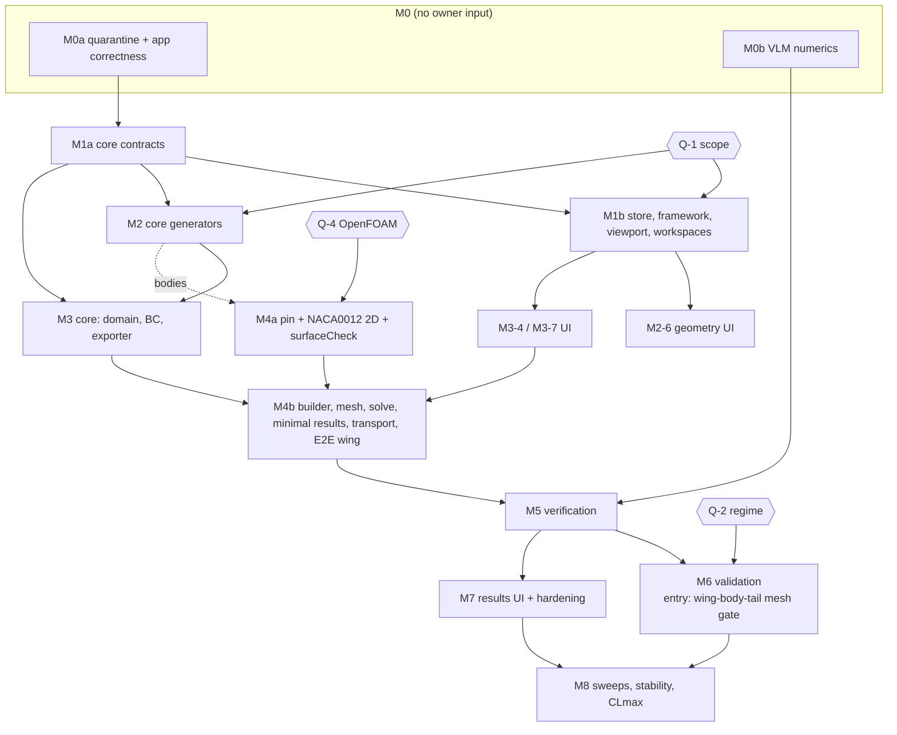

# Phased Implementation Plan

Status: **v1.0**, revised after the adversarial review (2026-10-23). Precedence: [DATA_CONTRACTS](../architecture/DATA_CONTRACTS_AND_PIPELINE.md) (normative) > [MASTER plan](MASTER_REVISED_PROJECT_PLAN.md) > this plan > [IMPLEMENTATION_HANDOFF](IMPLEMENTATION_HANDOFF.md).

- Test IDs are defined in [VALIDATION_AND_TEST_MATRIX.md](VALIDATION_AND_TEST_MATRIX.md).
- `DR-xx` IDs refer to the [discrepancy register](../audits/DISCREPANCY_REGISTER.md).
- `RA-xx` and `RB-xx` IDs refer to the [review dispositions](../audits/ADVERSARIAL_PLAN_REVIEW.md).
- File and line references are to commit `25afe85`.

**Conventions for every task:**
- Pure logic lives in a module with no DOM, no three.js and no bare-specifier imports (RA-20).
- A task is done only when its tests exist, pass, and run under `npm test` (browser and core) or `pytest` (backend). Tests needing OpenFOAM run under `pytest -m openfoam`.
- Documentation describing changed behaviour is updated in the same change (DEC-14).
- Every new runtime dependency needs a recorded decision. Vendored libraries are pinned by exact version and SHA-256.

**Owner decisions gate the tracks** (master plan §7):

| Decision | Required before |
|---|---|
| Q-1 (scope) | M1b, M2, M3 |
| Q-4 (OpenFOAM install) | M4a |
| Q-2 (regime) | M6 |

---

## M0a: Quarantine and app correctness

**Objective.** No displayed number is wrong without being labelled. Each one is either correct (within Tier-0 limits) or explicitly unavailable.

**Prerequisites.** None. M0a is valid under either Q-1 answer.

| ID | Task | Files (current lines) | Fixes | Tests |
|---|---|---|---|---|
| M0-6 | **Planform by slicing.** Replace the vertex-binned envelope with triangle–plane slicing at K = max(48, 4·√n) stations. Chord = max x − min x of the edge intersections. The midline z comes from the slice. | `src/recognition.js:112-215` | DR-03 | REC-V1, REC-V2 |
| M0-7 | **Validity gate.** Separate `errors` from `warnings`; set `valid = errors.length === 0`. Add plausibility errors (span, MAC, coverage) and a half-wing warning. | `src/recognition.js:190-196` | DR-04 | REC-V3 |
| M0-8 | **Stability gating** (DATA_CONTRACTS §2.5 verdict rules; RB-01). • Verdict only when all hold: a valid H-tail; a mass source other than the default lump (`assumedUniform`); the linearity rule. • The verdict text names the model and states that omitting the fuselage over-estimates SM. • Otherwise show "wing-alone" or "assumed mass: verdict withheld". • Hide the pitch plot behind a "non-physical demonstrator" disclosure. • Delete `computeStaticStability`, or wire it in and retarget its test. | `src/app.js:321-323, 756, ~790`; `src/stability.js:4-36`; `src/massModel.js` (`source` flag) | DR-05, DR-06, DR-39 | STAB-V2, STAB-V3, VM-T1 |
| M0-9 | **Project restore.** • Minimal `src/core/hash.js` using `crypto.subtle` SHA-256 (works in Node 24 and the browser). • Snapshots record `source.meshHash` and are written asynchronously. • Restore applies unit and axis mapping before assignments, and rejects a hash mismatch. | `src/app.js:806-832`; `src/projectState.js` | DR-07, DR-08, DR-45 | ID-T1, ID-T3, ID-T4 |
| M0-10 | **Exact topology** as the new module `src/core/topology.js`. M1-1 extends it, so this is not throwaway work (RA-09). • Exact weld with a typed-array hash. • Degenerate triangles excluded from the edge map. • Edge-connected components. • `geometry.js` and the regression test switch to it: 28 / 5 / 0 / 1. | `src/core/topology.js`; `src/geometry.js:130-200`; `tests/demoRegression.test.mjs:18-19` | DR-12 | TOPO-T1, TOPO-T2 |
| M0-11 | **Stale results.** A pure view-model `resultState(inputsHash, result)` decides fresh, stale or absent. Canvases are cleared or greyed when stale. | `src/core/viewModels.js`; `src/app.js:770, 898-907`; `src/graphs.js` | DR-23 | VM-T2 |
| M0-12 | **Degraded mode.** Isolate viewer initialisation so a WebGL failure leaves import, analysis and plots working, with a banner. | `src/app.js:88-98, 389-411` | DR-24 | UI-T1 (M) |
| M0-13 | Reject non-finite vertices on import, reporting the triangle id. | `src/stlParser.js` | DR-27 | ID-T6 |
| M0-14 | **Labels.** • "C_Di (VLM) + assumed C_D0". • C_m reference point and its source. • Bounds seed flagged as a placeholder. • Seed height uses the CG z. | `src/app.js:365, 775-781`; `src/stability.js:77-88` | DR-34, DR-36, DR-43 | VM-T1, VLM-V8 |
| M0-15 | **Hygiene.** • Server `URIError` → 400. • Remove `?v=` query strings. • Remove the orphan `reference/xflr5` gitlink (owner approval). | `server.mjs:21`; `src/app.js:22-24`; `index.html:7, 160` | DR-37, DR-38, DR-40 | SRV-T1 |

## M0b: Tier-0 VLM numerics

**Prerequisites.** None. Runs in parallel with M0a. It is needed by XVAL-T1 in M5 and by the Quick Aero view.

| ID | Task | Files | Fixes | Tests |
|---|---|---|---|---|
| M0-1 | **Induced drag.** • Induced velocity at bound midpoints includes the panel's own trailing legs (`includeBound = j !== i`). • Remove `Math.abs`. • Add `trefftzDrag()` in the **general transverse-plane form**: every trailing leg of every surface, projected onto the plane ⟂ to the wake (DATA_CONTRACTS §2.7; RB-03). Use it as the primary C_Di; the near-field value is a diagnostic. Assert D > 0. | `src/vlmSolver.js:121-147` | DR-01 | VLM-V2, VLM-V2b, VLM-V2c |
| M0-2 | **Multi-row VLM** (RA-03, RB-04; measurements in the review record §4). • M chordwise rows (default 4); uniform spacing; N chosen so width/length ≈ 1. • **Single guard: refuse any panel with width/length < 0.25**; warn above 8. • Freestream-aligned wake, length ≥ 10 b (RB-07; DATA_CONTRACTS §2.7). • Resolution check R1 vs R2 shown as a badge (amber if ΔC_Lα > 1 % or ΔC_Di > 5 %). • Output labelled "flat-plate inviscid estimate: C_Lα ±5 %, C_Di ±8 %". | `src/vlmSolver.js:21-61, 85-171`; `index.html:121` | DR-02, B-VLM-04, B-VLM-07 | VLM-V1, VLM-V1b, VLM-V2d, VLM-V3 |
| M0-3 | Sweep input is c/4 sweep, converted to leading-edge sweep. | `src/vlmSolver.js:270-276` | DR-21 | VLM-V6 |
| M0-4 | Relative singularity cutoff. | `src/vlmSolver.js:2, 71` | DR-35 | VLM-V5 |
| M0-5 | **Linear-window guard:** ≥ 3 points in the window, otherwise "insufficient linear data". | `src/vlmSolver.js:204-224` | DR-26 | VLM-V7 |
| M0-16 | **Docs.** • Update CALCULATION_PIPELINE §6.1, §11, §15, §16 and MVP_METHODOLOGY L43-47 and the limitations. • The demo report is produced by `scripts/demo-report.mjs`. | docs, `scripts/` | DEC-14 | DOC-T1 |

**G0 (M0a + M0b)**:
- Every M0 test passes.
- Every displayed numeric output carries a validity status.
- DR-01..DR-08 are closed.
- The demo report has been regenerated.

---

## M1a: Core contracts (pure, no UI)

**Prerequisites.** G0 (M0-9, M0-10). The surface model is useful for VLM recognition under either Q-1 answer; the BC parts assume CFD scope.

| ID | Task | Files | Tests |
|---|---|---|---|
| M1-1 | **Topology core.** • Optional relative-tolerance weld with a neighbour-cell check. • CSR adjacency. • Feature edges. • Per-surface and per-body closure report. • `recognition.js` adjacency switches to it. | `src/core/topology.js`; `src/recognition.js:26-60` | TOPO-T3, PERF-T1 |
| M1-2 | **Hashing.** • `meshHash` (imported) and `paramsHash` (generated: canonical JSON + `generatorVersion`). • `inputsHash` (FNV-1a, synchronous). • `physicsHash` (SHA-256 at export). See RA-10 and RA-11. | `src/core/hash.js` | ID-T1, ID-T7 |
| M1-3 | **Surface model.** • Surfaces, **bodies** (closed shells, the export unit) and **components** (semantic) (RA-07). • Operations; name rules incl. reserved domain names and case-insensitive uniqueness; length caps (RA-16). | `src/core/surfaceModel.js` | SURF-T1..T4 |
| M1-4 | **Spatial index** (RA-12). • Uniform grid plus triangle AABB tree. • Ray, nearest, box, triangle–triangle intersection and inside (winding-number) queries. | `src/core/spatial.js` | SPAT-T1 |
| M1-5 | **Selection core** (pure). • `pickToTriangleId`. • Add, remove and replace modes. • Flood with a 30° adjacent-dihedral limit, a seed cone, barriers (surface boundaries and feature edges) and a cap. • Plane split; box select over projected centroids. | `src/core/selection.js`; `src/recognition.js:62-95` (moved) | SEL-T1, SEL-T3, SEL-T5 |
| M1-6 | **Import.** • ASCII multi-solid names become provisional surfaces after deterministic sanitisation. • Axis map with det = −1 flips the winding. • Name round-trip through the writer. | `src/stlParser.js`; `src/axisMapping.js` | ID-T5, EXP-T2, SURF-T4 |
| M1-7 | **Schemas.** • `schemas/aircraft-params`, `case-manifest` (provisional v0, frozen in M3), `result-bundle`, `browser-project` v2. • A generated JS copy, kept in sync by a parity test. | `schemas/`, `src/core/schemas.js` | EXP-T4 |

**G1a.** All listed tests pass. Core modules have zero bare imports, checked by a lint test (LINT-T1).

## M1b: Interaction (store, framework, viewport, shell)

**Prerequisites.** G1a; the owner's answer to Q-1.

| ID | Task | Files | Tests |
|---|---|---|---|
| M1-8 | **Framework decision** (DEC-10, RA-15). • Default: Preact + htm, vendored at exact versions, loaded through the same import map as `three`. • Record the decision in `docs/decisions/`. | `vendor/`, `index.html` | — |
| M1-9 | **Store.** • Actions and subscriptions; gesture-coalesced undo (surface and boundary operations; 100 steps). • Snapshot v2 with v1 migration. • `app.js` state migrates into it. | `src/state/store.js`; `src/projectState.js` | STORE-T1, ID-T2, ID-T3, SURF-T3 |
| M1-10 | **Viewport service.** • Lazy renderer; on-demand rendering; dispose; context loss. • Pan, zoom-to-cursor, fit. • `#FF6600` highlight with run-coalesced partial updates (RA-19). • Single three instance through the import map. | `src/view/viewport.js`, `src/view/picking.js` | UI-T1, UI-T4 (M), PERF-T2 (M) |
| M1-11 | **Guided workspaces.** • Geometry → Surfaces & Boundaries → Domain & Flow → Run → Results (Quick Aero inside Results). • Model tree and inspector. • Persistent blocking-issues panel. | `src/ui/*` | UI-T6 (M), VM-T3 |
| M1-12 | **Manual QA checklist**, `docs/qa/MANUAL_CHECKLIST.md`. Each M-level item has a named signer and records the machine (RA-08, RA-18). | docs | — |
| M1-13 | **Spike S-2 (BVH).** Pinned three-mesh-bvh. Measure `faceIndex → triangleId` with the default and `indirect` builds, plus timings. Write `docs/spikes/S-2-bvh.md`, recording adopt or defer. | spike branch | SEL-T1 (BVH variant) |
| M1-14 | **A320 tagging workflow**, documented in `docs/workflows/TAG_IMPORTED_MESH.md`. | docs | SEL-T4 |

**G1b.**
- The A320 is tagged into `fuselage`, `wing_l`, `wing_r`, `htail` and `vtail`, plus nacelles and pylons if desired, through the UI.
- The result survives save and load, verified by hash.
- The manual checklist is signed.

---

## M2: Parametric geometry with surface provenance

**Prerequisites.**
- Core tasks M2-1..M2-5 and M2-7 need G1a.
- M2-6 (UI) needs G1b.
- Q-1 answered.

| ID | Task | Files | Tests |
|---|---|---|---|
| M2-1 | **NACA 4-digit section.** • `trailingEdge: "blunt"` is the default: a₄ = −0.1015 with a `te_base` surface (RB-19). • `"sharp"` (a₄ = −0.1036) is optional. • Cosine sampling. | `src/geometry/naca4.js` | GEO-T1 |
| M2-2 | **Lifting-surface loft.** • Full or semi span. • Twist about c/4. • c/4 → leading-edge sweep. • Shear dihedral. • Taper; caps; mount-angle placement. | `src/geometry/liftingSurface.js` | GEO-T2, GEO-T4 |
| M2-3 | **Superellipse fuselage.** Profiles, upsweep, adaptive sampling, apex closure. | `src/geometry/fuselage.js` | GEO-T3 |
| M2-4 | **Empennage presets**: conventional, T, V, H, inverted-U. | `src/geometry/empennage.js` | GEO-T6 |
| M2-5 | **Assembly.** • `AircraftParams`, with presets `uav-default` and `transport-like`. • Bodies and components. • Intersection pairs via the spatial index. • `expectedEmpty` (buried caps) via inside tests. | `src/geometry/assembly.js` | GEO-T5, GEO-T7 |
| M2-6 | **Geometry workspace.** Forms and debounced preview. | `src/ui/geometry*.js` | PERF-T3, UI-T6 (M) |
| M2-7 | **Analytic references**: S, c̄, b, x_MAC. The Tier-0 VLM consumes them directly. | `src/geometry/reference.js` | VLM-V9 |
| M2-8 | **Spike S-3 (optional).** Manifold union with provenance, on 200 random assemblies. Write `docs/spikes/S-3-manifold.md`. | spike branch | GEO-T5b |
| M2-9 | **Camber and twist in the Tier-0 VLM normals**, from the generated sections (RB-01). Uses the thin-airfoil camber-slope boundary condition at control points and incidence per strip. | `src/vlmSolver.js`, `src/geometry/reference.js` | VLM-V10 |

**G2.** GEO-T1..T7 pass with seeded randomised property tests (200 assemblies), and Quick Aero runs on a generated wing plus tail.

---

## M3: Boundary model, fluid domain, case export

**Prerequisites.** G1a and G2 for the core. M3-4 needs G1b.

| ID | Task | Files | Tests |
|---|---|---|---|
| M3-1 | **Atmosphere**: ISA, Re, Mach, turbulence inflow. | `src/core/atmosphere.js` | ATM-T1 |
| M3-2 | **Domain**: L_ref policy, extents, minimums, half model, face naming (reserved names). | `src/domain/domain.js` | DOM-T1 |
| M3-3 | **Boundary vocabulary and rules R1-R10** (incl. R6b), with machine-readable rule ids. | `src/domain/bc.js` | BC-T1..T8 |
| M3-4 | **Surfaces & Boundaries / Domain & Flow UI**: per-face colours, legend, U∞ arrow, blocking-issues panel. | `src/ui/*` | UI-T7 (M), VM-T3 |
| M3-5 | **Freeze `case-manifest` v1.** Shared positive and negative fixtures, each naming its expected rule id. | `schemas/`, `tests/fixtures/cases/*` (generated at test time) | EXP-T4 |
| M3-6 | **Exporter.** • One multi-solid ASCII STL per body. • Closure gate; half-model clipping (bodies wholly at y < 0 omitted and recorded); `expectedEmpty`. • Surface-based force groups; `physicsHash`. | `src/export/caseExport.js`, `src/stlParser.js` | EXP-T1..T3 |
| M3-7 | **Run workspace** (settings part): flow, α list, references with their source, mesh preset (target sizes, not levels). | `src/ui/run*.js` | VM-T3 |

**G3.**
- Bundles for (a) a rectangular NACA 0012 wing half model and (b) a conventional wing-body-tail validate in JS and Python.
- Every negative fixture is refused with its rule id on both sides.

---

## M4: Reproducible meshing and solver runner

### M4a: Solver baseline

Starts when the owner answers Q-4. It is independent of M0-M3.

| ID | Task | Files | Tests |
|---|---|---|---|
| M4-1 | **Install and pin OpenFOAM** (DEC-08). • Environment check. • **Probe the `regions` name-override behaviour** with a 2-region STL (RA-01). • Verify Python dependencies on the host interpreter (numpy, jsonschema). | `backend/airflow_case/foam_version.py`; `docs/ops/OPENFOAM_INSTALL.md` | CFD-T1 |
| M4-2 | **Backend skeleton**: CLI, names module, manifest validation against the provisional schema. | `backend/` | EXP-T4 (Python) |
| M4-3 | **2-D NACA 0012** (NASA TMR) case and acceptance script (RB-05, RB-12). • **TMR coordinates and grid family.** Far field at about 500 chords, or an extruded 2-D mesh with ≥ 100 c plus a point-vortex correction. The 3-D domain rule does not apply (DATA_CONTRACTS §6.2). • TMR-conforming turbulence inflow. • Compressibility step **measured**: a compressible solver at M = 0.15 and simpleFoam, both on the same mesh, rather than assumed by Prandtl-Glauert. • snappyHexMesh slab run for quantification only. • α = 15° gated only if the solution is steady. • Reference data and citation in `validation/naca0012_2d/REFERENCE.md`. | `validation/naca0012_2d/` | CFD-T2 |
| M4-3b | **`surfaceCheck` on generated bodies** exported by a script (available from G2). | `backend/tests` | EXP-T5 |

### M4b: 3D runner, transport, end-to-end

**Prerequisites.** G3 and M4a.

| ID | Task | Files | Tests |
|---|---|---|---|
| M4-4 | **Deterministic case builder.** • Templates. • `regions` overrides so patch = surface. • `expectedEmpty` excluded from function objects. • `locationInMesh` via inside tests. | `build.py`, `templates/` | BLD-T1 |
| M4-5 | **Mesh stage**: Boolean features per pair, snappy, MeshReport and gates. | `mesh.py` | MESH-T1, MESH-T3, MESH-T4 |
| M4-6 | **Solve stage**: U rotation per α, function objects, convergence gate. | `solve.py` | CFD-T3 |
| M4-6b | **Minimal coefficient parser and ResultBundle writer** (RA-04). M5 adds the cross-checks. | `post.py`, `results.py` | CFD-T6 |
| M4-7 | **Job runner**: job directories, `status.json`, timeouts, failure taxonomy. | `jobs.py` | CFD-T4 |
| M4-9 | **Transport** (RA-02). • `airflow-case serve` on 127.0.0.1 serves the static app and `/api` (no CORS). • Browser API client. • Upload size limits; names validated server-side. | `server.py`, `src/api/client.js` | API-T1..T3 |
| M4-10 | **Cell estimate** endpoint (dry-run builder) and UI display. | `cli.py estimate` | UI-T8 |
| M4-11 | **Spike S-4 (junction quality).** On a wing-body case, compare overlapping bodies plus Boolean features against a Manifold-unioned shell: layer coverage at the junction, skewness, ΔC_L, ΔC_D. Recommend one; write `docs/spikes/S-4-junction.md`. | spike | — |
| M4-8 | **End-to-end**: browser-exported rectangular-wing bundle, α ∈ {−2, 0, 2, 4, 6}. | — | E2E-T1 |

**G4 (wing only)** (RA-04).
- CFD-T1..T4 and T6, MESH-T1/T3/T4, API-T1..T3 and E2E-T1 pass.
- CFD-T2 passes within its gates.
- S-4 is reported.

---

## M5: Coefficient verification

**Prerequisites.** G4.

| ID | Task | Tests |
|---|---|---|
| M5-1 | Pressure/viscous split and per-group parsing. | CFD-T5 |
| M5-2 | **Independent integration.** numpy integration of `p` and `wallShearStress` from function-object surface output; compare with forceCoeffs. | CFD-T7 |
| M5-3 | Moment transfer between two references. | CFD-T5 |
| M5-4 | Half model vs full model. | CFD-T8 |
| M5-5 | Surfaces, slices and streamlines to the aligned binary format; C_p sanity checks. | CFD-T9, FMT-T1 |
| M5-6 | Browser ResultBundle loader; staleness by `physicsHash`; pure plot view models. | VM-T2, UI-T11 |
| M5-7 | VLM vs RANS linear-range consistency. | XVAL-T1 |

**G5.** All tests pass.
- Every coefficient has an **extraction** cross-check (CFD-T7, CFD-T9).
- **Physical** cross-checks exist only where listed: XVAL-T1 for C_Lα (RB-02).
- Every coefficient record carries the regime flags (DATA_CONTRACTS §2.1).

---

## M6: Scientific validation, convergence, uncertainty

**Prerequisites.** G5; the owner's answer to Q-2. **Entry gate:** MESH-T2 (wing-body-tail meshes within the gates), using the S-4 recommendation.

| ID | Task | Tests |
|---|---|---|
| M6-1 | **GCI study.** Effective refinement ratio from cell counts; observed order reported; non-monotone convergence handled per Celik et al. (RB-18). | VAL-G1 |
| M6-2 | **Domain-size study.** Near-body mesh frozen; outer blocks extended; Richardson-estimated residual (RB-18). | VAL-D1 |
| M6-3 | Iterative-convergence sensitivity. | VAL-I1 |
| M6-4 | **Experimental validation** (RB-17): • **VAL-E1a:** NASA TP-3151 as a C_p-distribution and tip-vortex benchmark. • **VAL-E1b:** a force-balance 3-D wing dataset for C_Lα and C_D, selected and cited before any runs (U-2). | VAL-E1a, VAL-E1b |
| M6-5 | **Wall-treatment sensitivity** (RB-06). Fixes the production wall treatment for the validated regime. | VAL-Y1 |
| M6-6 | Uncertainty propagated into the ResultBundle and the UI. | VM-T4 |
| M6-7 | **Select VAL-E2**: a published wing-body-tail dataset with C_m-α or NP, read and cited (U-1). Required before any validated CFD stability claim (RB-02). | — |

**Deliverable.** `validation/REPORT.md`, generated by script. **G6.**

---

## M7: Results UI and hardening

**Prerequisites.** G5.

| ID | Task | Tests |
|---|---|---|
| M7-1 | **Results views**: C_L-α, C_D-α, C_m-α, polar, per-group breakdown, convergence markers, uncertainty bands. | UI-T11, VM-T4 |
| M7-2 | **Surface and flow views**: C_p/C_f surface contours (diverging scale centred at 0), slices, streamlines. | VM-T5, PERF-T4 (M) |
| M7-3 | **Job monitor**: logs, residual and coefficient histories, failure reasons. | UI-T13 (M) |
| M7-4 | **Deferred from earlier milestones** (RA-22): • Workers for topology and the VLM. • Parameter undo. • Optional tag transfer for re-exported STLs. • Decision on browser automation (Playwright). | PERF-T1 (worker) |
| M7-5 | **Accessibility basics.** | UI-T10 (M) |

**G7.**

---

## M8: Sweeps, CFD stability, qualified C_L,max

**Prerequisites.** G6, G7.

| ID | Task | Tests |
|---|---|---|
| M8-1 | **Automated α sweeps**, ascending and descending with continuation. Wake region covers the α range; sweeps wider than 10° are split (RB-14). | CLMAX-T2 |
| M8-2 | **CFD static stability**: wing-body-tail, trim incidence, NP at z_CG, SM. • Labelled "unvalidated" until VAL-E2 passes (RB-02). • Tail plausibility check (STAB-C3) and tail-wake resolution probe (STAB-C4). | STAB-C1, STAB-C2 (post-processor), STAB-C3, STAB-C4, VAL-E2 |
| M8-3 | **Qualified C_L,max**: full model only, M ≤ 0.2, Δα ≤ 1° near the peak, local fit (RB-13). | CLMAX-T1, CLMAX-T3 |
| M8-4 | **Short-period model** with a sourced C_mq. | STAB-V1 |
| M8-5 | **Research tier** (not committed). | — |

---

## Dependency graph

